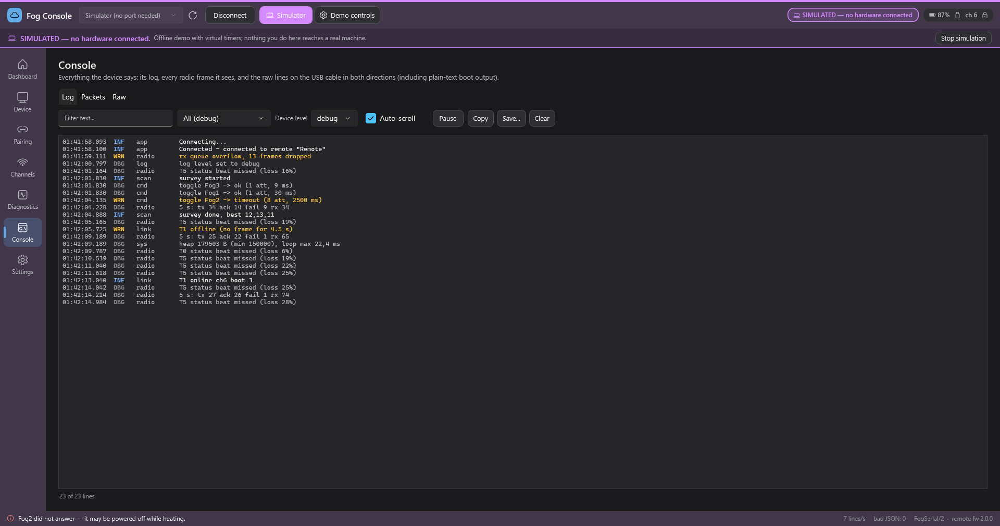

# Fog Console

Fog Console is the Windows tool for the smoke machine timer system. Plug the **remote** into a USB port
(or, for bench work, a single **timer**) and you get a live dashboard of every machine, one-click
control, pairing, radio-channel tools and a full set of diagnostics - all over the
[FogSerial/2 protocol](../docs/SERIAL_PROTOCOL.md) (JSON lines over the USB serial port).

No hardware at hand? Click **Try the offline demo** on the start screen. A built-in simulator behaves like
a remote with up to ten timers (heating-up power cuts, packet loss, Wi-Fi interference included), so every
page can be explored and tested without a single device.


| | |
|---|---|
|  |  |
|  |  |
|  |  |

Every page also exists in a light theme (`docs/*-light.png`). The theme follows Windows by default and can be
switched in **Settings**.

## Build and run

Requirements: Windows 10/11 and the .NET 10 SDK (`dotnet --version` should say 10.x).

```powershell
dotnet build PCDiagnostics\FogConsole.sln -c Release
dotnet run --project PCDiagnostics\FogConsole\FogConsole.csproj
dotnet test PCDiagnostics\FogConsole.sln
```

The executable ends up in `PCDiagnostics\FogConsole\bin\Release\net10.0-windows\FogConsole.exe`.
NuGet packages: `CommunityToolkit.Mvvm`, `System.IO.Ports`, `System.Management` (friendly COM port names). Nothing else.

The window **always opens maximized**. Its normal (restored) size and position are remembered and used when you
un-maximize it. The layout adapts from 1000 px up to 4K: dashboard cards reflow into as many columns as fit.

## Using it

1. Plug in the remote (USB-C). Pick its COM port (the Espressif/XIAO device is pre-selected) and press **Connect**.
   If the device is asleep or unplugged the tool waits and connects by itself when the port appears; it also
   reconnects after the remote re-enumerates (reboot, factory reset, channel change).
2. **Dashboard** - one card per timer: countdown ring, phase, signal bars with loss, **Hold to fog**, Toggle, Reset,
   Pause/Resume, Identify. Buttons in the header act on all timers: Pause, Resume, Reset, Toggle, *Apply times to
   all...* and *Stagger start* (spreads the cycle phases evenly so the machines do not all fire at the same moment).
3. **Device** - details of one timer: live state, ON/OFF durations (sliders, presets, saved presets), 60 s cycle
   timeline, 5 minute signal/loss graph, rename, start phase after power-up, move one timer to another channel,
   identify, reboot, factory reset, and the recent commands with their results.
4. **Pairing** - discover timers around (optionally sweeping all channels), pair/unpair with a name.
5. **Channels** - survey the 2.4 GHz band, see which channel is quiet, move the whole system with confirmation and
   progress; **Find lost timers** (timers that missed a channel change while powered off); **Link Lab** sends a burst
   of pings to one timer and plots delivery and round-trip time so you can compare channels or distances.
6. **Diagnostics** - the performance counters of every radio, on both ends of each link (see below).
7. **Console** - *Log* (device log with level filter), *Packets* (every radio frame the remote sees) and *Raw* (every
   line on the USB cable in both directions, plus a box to send your own JSON line).
8. **Firmware** - update the remote or a timer over its USB cable: the firmware is recognised (timer or remote, version), checked
   (ESP32-C3 image, checksum, SHA-256), written through the chip's ROM bootloader and verified by the chip's MD5; settings and pairing
   survive an *Update*. *Check device* identifies the chip and compares the flash without writing. See [`docs/FIRMWARE_UPDATE.md`](../docs/FIRMWARE_UPDATE.md).
   The second route, **Over the air (through the remote)**, updates the timers while they stay inside their machines: tick the timers, *Check support*,
   *Update selected timers*. The PC runs the transfer (windowed, selective repeat, SHA-256 check, activation, wait for the new version); the remote only
   forwards frames (`otaTx` / `otaRx` / `otaHold` of FogSerial/2). The first update of a timer, and every remote update, is still over USB.
   See [`docs/OTA_UPDATE.md`](../docs/OTA_UPDATE.md) for the protocol and the Fog Console manual for the page.
9. **Settings** - the remote's settings (TX power, brightness, auto-off, signal bar range, battery calibration; for a
   timer on USB its name, durations and start phase) and this application's preferences (theme, buffer sizes,
   simulator options, the over-the-air key - default `FogLink-OTA-v1`, the same text the timer firmware is built with).

Keyboard: `Ctrl+1` ... `Ctrl+8` switch pages, `F5` rescans the COM ports.
Settings are stored in `%AppData%\FogConsole\settings.json`; unexpected errors are written to
`%AppData%\FogConsole\crash.log`.

### Safety

* **Hold to fog** is momentary: the output is forced on only while you hold the button (or the space bar on a
  focused button). It is a dead-man lease, refreshed every 300 ms; letting go, losing focus, deactivating the
  window or losing the connection releases it, and the timer's own lease runs out within a second even if the PC dies.
* A red banner across the top appears whenever any timer reports *force on*.
* Destructive actions (factory reset, reboot, unpair, moving a timer or the whole system to another channel,
  resetting all timers) ask for confirmation first.
* Every command shows its real outcome: confirmed (with attempts and time), rejected, or timed out with a plain
  explanation (for example "Fog3 did not answer - it may be powered off while heating"). Bulk actions report
  "7/8 confirmed, Fog3 timed out".

## Offline demo (simulator)

The simulator is a first-class mode, not a test hook. Start it from the dashboard (**Try the offline demo**, next to
**Connect to a remote**), from the top bar (**Simulator**), or from the command line with `--sim`. While it runs,
a violet **SIMULATED** chip, a banner and a tinted window make it impossible to confuse with real hardware.
The **Demo controls** panel lets you stage situations:

* number of timers (1 - 10), packet loss in %,
* **Cut power (30 s)** to a timer - it goes offline, reboots and shows a REBOOTED badge (a brownout is counted
  on the Diagnostics page),
* **Inject interference** - a jammer appears on the current channel; run a survey, move to a quiet channel and watch
  the link recover (the whole point of the Channels page),
* pause / resume simulated time, and the random **seed** (same seed = same story).

Everything works offline: pairing, channel survey and migration, link tests, counters, console, settings.

## Diagnostics page

Every device counts what happens on its radio. The page shows, for the remote and for every timer:

* radio counters (sent, acknowledged, failed, received, bad, foreign, dropped, watchdog), commands and retries,
  round-trip times, sweeps, resets by cause (power-on, brownout, watchdog, panic, ...), heap, loop time, the USB link to the PC,
* per-second **rates** and 5-minute sparklines, and the link as the remote sees it (loss, lost/expected, MAC failures,
  RSSI min/avg/max) next to the timer's own view,
* **health chips** that call out what looks wrong (frame loss, weak signal, unacknowledged frames, receive queue drops,
  slow loop, low heap, command timeouts, offline events, reboots, brownouts, watchdog and panic resets), with an explanation on hover,
* a **channel quality** table (failures per channel since you pressed *Reset*),
* **Copy as JSON**, **Export CSV...** and a **snapshot compare** (set a baseline, change something - channel,
  power, position - and see the difference).

The counter stream (`statsCfg`) is switched on only while the page is visible and off again when you leave it.

## Command line

```
FogConsole.exe [--sim] [--sim-timer] [--seed N] [--paired N]
               [--page Dashboard|Device|Pairing|Channels|Diagnostics|Console|Firmware|Settings] [--select N]
               [--theme light|dark|system] [--size WxH] [--no-chaos] [--no-demo] [--no-settings]
               [--shot out.png [--shot-scale 1]] [--delay secs] [--exit] [--action name] [--scroll px]
```

| option | meaning |
|--------|---------|
| `--sim` | start the simulated remote immediately; `--sim-timer` simulates a single timer on USB instead |
| `--seed N` | simulator random seed (default 42): same seed, same behaviour |
| `--paired N` | number of simulated, already paired timers (0 - 10) |
| `--page`, `--select N` | page to open and device index to select |
| `--theme` | force light or dark for this run |
| `--size WxH` | size of the restored window (it still opens maximized; screenshots use this size) |
| `--no-chaos` | the simulator makes no random power cuts, so a picture does not change between runs |
| `--no-demo` | skip the scripted start of the simulator (one timer already powered off and "heating up", another that briefly loses power and comes back rebooted) |
| `--no-settings` | do not read or write the settings file (implied by `--shot`) |
| `--shot file.png` | render the window to a PNG after `--delay` seconds (default 4); `--shot-scale 1` = one pixel per DIP (small files) |
| `--exit` | quit after the screenshot; without `--shot` run for `--delay` seconds and quit (a quick smoke test, exit code 0 = no crash) |
| `--action name` | prepare a situation before the shot: `survey`, `linktest`, `migrate`, `fail`, `baseline`, `hold`, `forceon`, `rename`, `device`, `console`, `packets`, `raw`, `discover`, `simpanel`, `showcase`, `firmware`, `firmwareflash`, `firmwaredone`, `otaready`, `otaprogress`, `otadone`, `otafail` |
| `--scroll px` | scroll the page content before the shot |

The pictures above come from `docs\make-screenshots.ps1`, which runs the app with `--sim --seed 42` once per page and theme
(`powershell -ExecutionPolicy Bypass -File PCDiagnostics\docs\make-screenshots.ps1`).

## Source layout

```
PCDiagnostics/
  FogConsole.sln
  FogConsole/                  WPF app (net10.0-windows, MVVM with CommunityToolkit.Mvvm)
    Protocol/                  messages, tolerant JSON parser, request builders
    Transport/                 ITransport, line framing, serial port (+ friendly port names)
    Hub/                       HubClient: request/response matching, keep-alive, reconnect, command tracking
    Simulator/                 virtual remote + timers + 2.4 GHz band (deterministic, seeded); each timer has a model of the over-the-air
                               receiver (SimOtaReceiver), including timers without a second slot and timers without OTA firmware
    Flashing/                  USB firmware update: SLIP + ROM bootloader client (esptool protocol), image/partition parsing,
                               firmware catalog, flash plans, simulated chip (SimulatedRom) and demo images
    Ota/                       over-the-air update: frames and HMAC authentication (OtaProtocol), the transfer state machine with an
                               injectable clock (OtaTransfer), capability probe, the link through the hub (OtaLink: up to 6 otaTx in
                               flight, retry on busy), the queue over several timers (OtaUpdater)
    Diagnostics/               counter maths, health rules, channel quality, snapshot compare/export
    Services/                  settings, theme, toasts, command center, hold-to-fog, dialogs, screenshots, startup options
    ViewModels/  Views/  Controls/  Converters/  Theme/
    Assets/FogConsole.ico      the application icon (drawn by tools/make-icon.ps1; preview: docs/app-icon.png)
  FogConsole.Tests/            xUnit: protocol, framing, hub, simulator, diagnostics, flashing (incl. the real esptool against the
                               simulated chip), over-the-air (spec test vectors, transfers over lossy / reordering / duplicating links
                               in virtual time, power cuts, wrong key, no slot, through the hub and the simulator, view model), view
                               models, end-to-end
  docs/                        screenshots, app-icon.png + make-screenshots.ps1
```

**Touch.** Every `ScrollViewer` gets finger panning when the first finger lands (`Controls/TouchScroll.cs`; WPF leaves `PanningMode` at `None`),
and the hold-to-fog buttons take the touch for themselves (`HoldBehavior` in `Controls/Panels.cs`: held while the finger rests on the button,
released when it lifts, is lost or slides more than 18 DIP away). `tools/touch-test.ps1` checks all of this with real injected touch input
(`InjectTouchInput`) on the running app: a drag on every page, a drag back, the slider thumb, and a hold with release and slide-off. It needs
a Windows desktop session that nobody touches while it runs: `pwsh -NoProfile -File tools/touch-test.ps1 [-Test all|pages|slider|hold]`.

The over-the-air tests include a **peer test**: `OtaPeerCompatibilityTests` drives `tools/native-tests/build/ota_peer.exe` - the timer's real receiver
code (`lib/FogLink/FogOta.cpp`) as a program - with the C# sender, so both languages are proven to speak the same protocol. The test is skipped
silently when the program has not been built (`powershell -File tools/native-tests/run.ps1` builds it).

`HubClient` only knows `ITransport`; the app uses either the serial transport or the simulator's in-memory transport,
so everything above the transport is the same code in both modes.
Protocol assumptions and open questions are in [PROTOCOL_NOTES.md](PROTOCOL_NOTES.md).
