# FogMachine Remote System

    

**One battery remote controls up to ten smoke-machine timers over ESP-NOW — and a Windows tool works as a second remote,
a configurator and a radio/link debugger.** Built for machines that **cut the power to their timer while they heat up** and
for radios that have to work in a noisy 2.4 GHz environment.

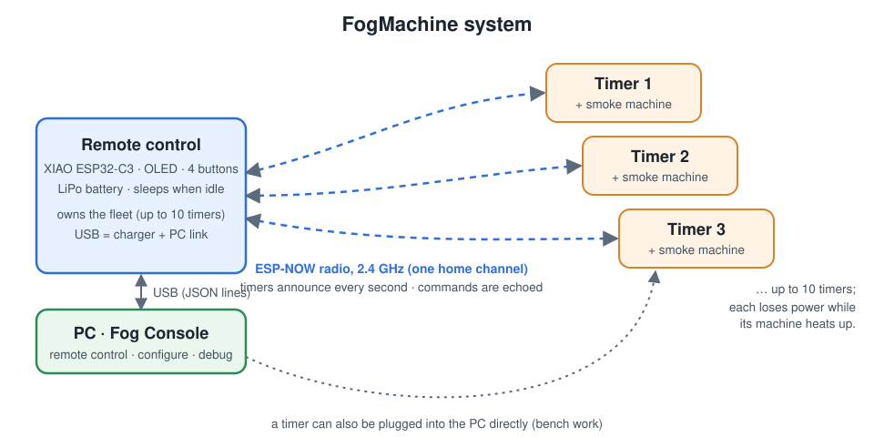

<table>
<tr>
<td align="center">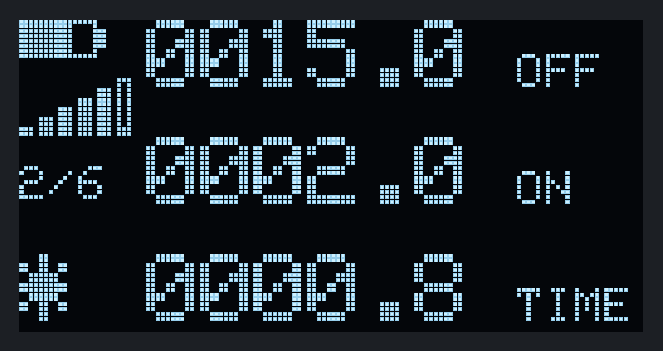<br><sub><b>Remote</b> – active timer: OFF / ON times and the running phase</sub></td>
<td align="center">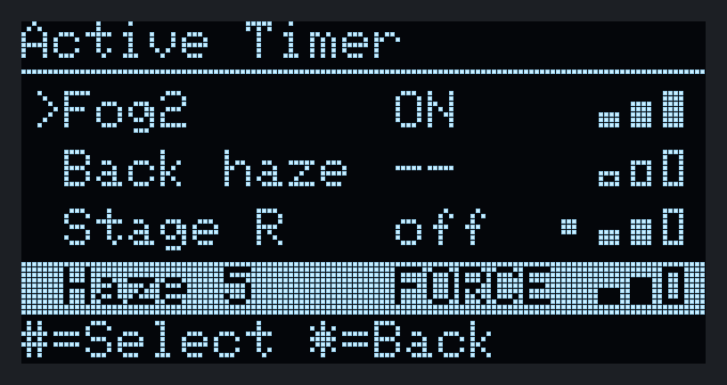<br><sub><b>All timers at a glance</b> – state and signal per timer</sub></td>
</tr>
<tr>
<td align="center">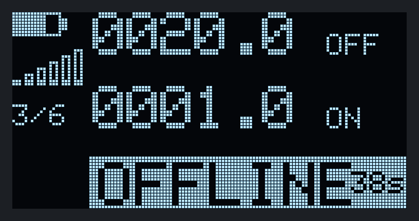<br><sub>A machine that is heating (no power) shows <b>OFFLINE</b></sub></td>
<td align="center">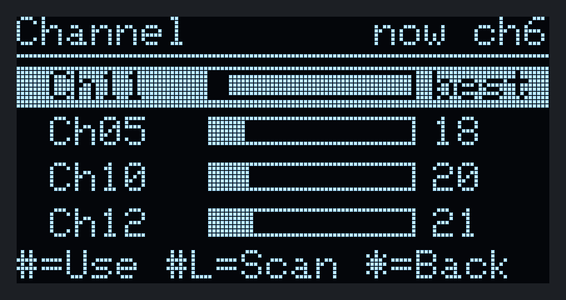<br><sub><b>Channel survey</b> – move the whole system to a quiet channel</sub></td>
</tr>
</table>


## Contents

* [Features](#features) · [How it works](#how-it-works) · [Screenshots](#screenshots) · [Quick start](#quick-start)
* [Hardware](#hardware) · [Documentation](#documentation) · [Repository layout](#repository-layout)
* [Building and testing](#building-and-testing) · [Safety](#safety) · [Status](#status) · [License](#license)

## Features

**Remote (handheld)**
* Up to **10 timers**; tap *UP/DOWN* to switch, *#* to edit the ON/OFF times (0.1 – 9999.9 s), *\** to toggle the phase.
* **Hold \* to fog** — a dead-man switch: the output stays on only while the remote keeps refreshing it.
* Fleet overview, link status (signal and packet loss per timer), *Find Timers*, *Link Test* and a **channel survey** with
  one-step migration of the whole system.
* Deep sleep after an idle time, wakes on *UP/DOWN*, knows the whole fleet again within about a second.

**Timer (on each machine)**
* Drift-free OFF/ON cycle, settings stored in non-volatile memory (written only when changed, CRC protected).
* **Power-cut tolerant:** output off first, radio back within ~0.3 s, announces that it was power-cycled, watchdog.
* Commands are acknowledged, **de-duplicated and never run late**.

**Radio (FogLink 2)**
* Timers announce, the remote listens: no polling, an idle remote sends nothing.
* Automatic **recovery sweeps** find timers that come back on another channel.
* Both ends keep **performance counters** (lost/retried packets, queue overflows, loop stalls, brown-outs, per-channel quality).

**Fog Console (Windows)**
* Dashboard with one card per timer, **hold-to-fog**, bulk actions, stagger start.
* **Firmware update over USB** for the remote and every timer: recognises timer/remote images, checks and verifies them, keeps
  settings and pairing — no PlatformIO needed.
* Device pages, pairing, channel survey / migration / link lab, **diagnostics with counters and health hints**, packet inspector,
  raw console, remote settings.
* **Offline demo mode** with a simulated fleet — try everything without hardware.
* Can also connect straight to a single timer's USB port for bench work.

## How it works

1. Every timer broadcasts a small status frame once a second (and immediately when its output changes).
2. The remote only listens, so after waking up it already knows every timer; there is no polling traffic.
3. A command from the remote is a short-lived job: it is retried until the timer echoes it or 2.5 s have passed, and the timer
   never executes a repeated command twice.
4. When a machine heats up and cuts power, its timer disappears (*OFFLINE*) and — without any queued commands — comes back
   by itself. If the system had moved to another channel meanwhile, the remote finds the timer and fetches it.

Details and the reasons the previous design was unreliable: [`docs/RADIO_PROTOCOL.md`](docs/RADIO_PROTOCOL.md).

## Screenshots

### The remote's OLED

These pictures are rendered by the **real firmware drawing code** on a PC (`tools/oled-preview`), so they match the device.

<table>
<tr>
<td align="center">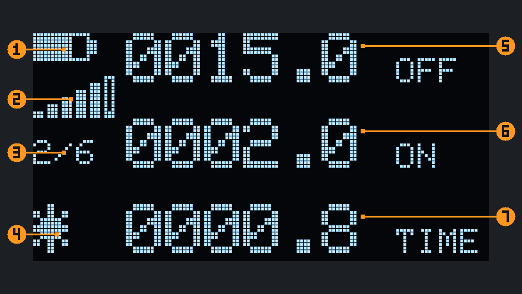<br><sub>Main screen explained (see the manual)</sub></td>
<td align="center">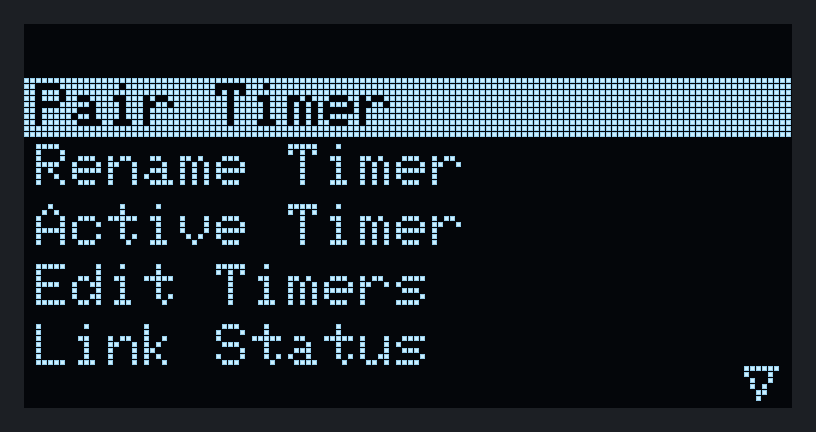<br><sub>Menu (hold <b>#</b>)</sub></td>
<td align="center">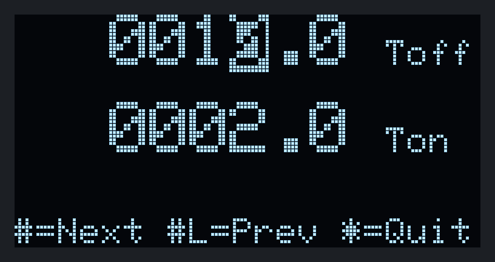<br><sub>Edit times, digit by digit</sub></td>
</tr>
<tr>
<td align="center">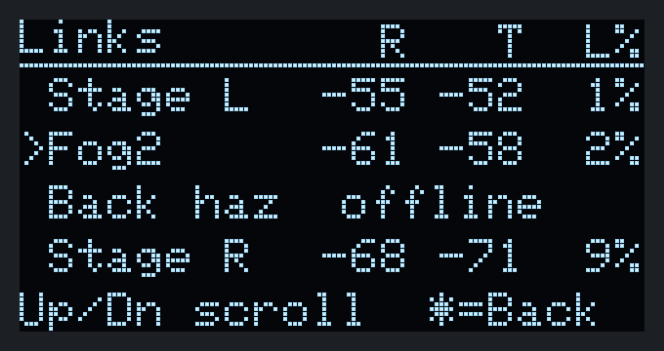<br><sub>Link status: signal both ways + loss</sub></td>
<td align="center">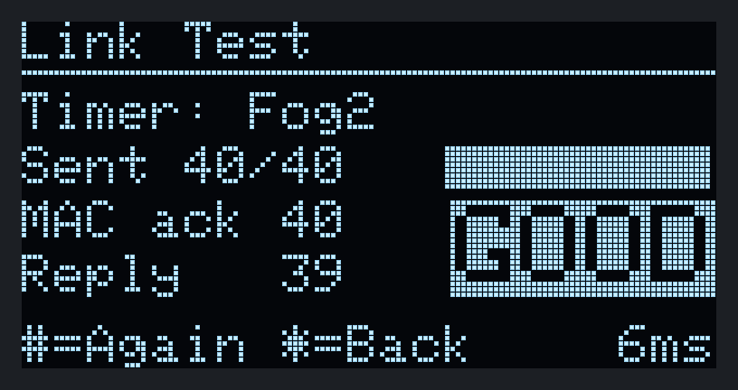<br><sub>Link test</sub></td>
<td align="center">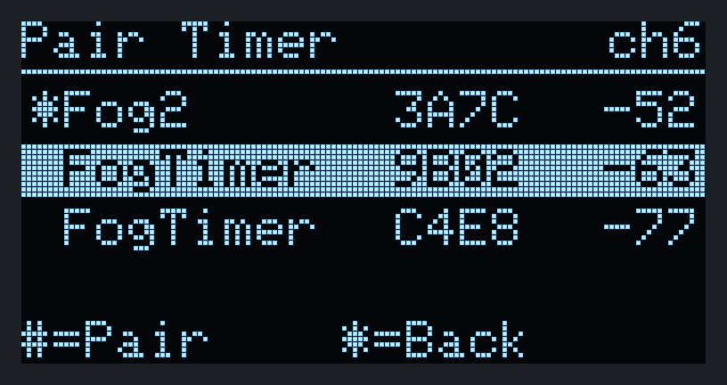<br><sub>Pairing</sub></td>
</tr>
<tr>
<td align="center">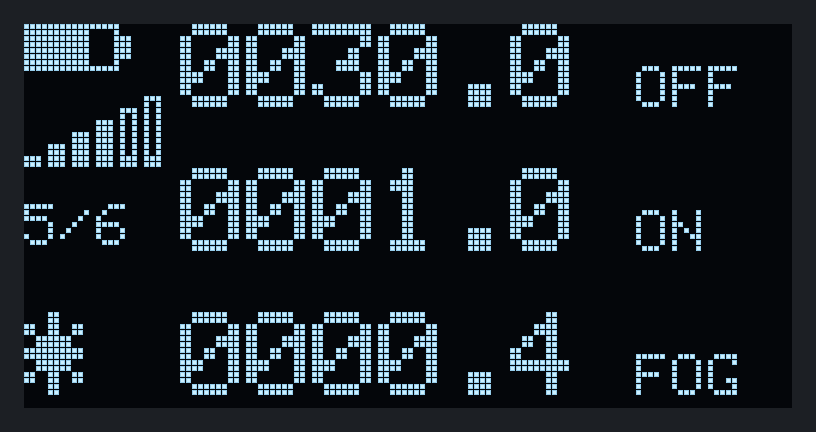<br><sub>Hold * = fog (FOG label)</sub></td>
<td align="center">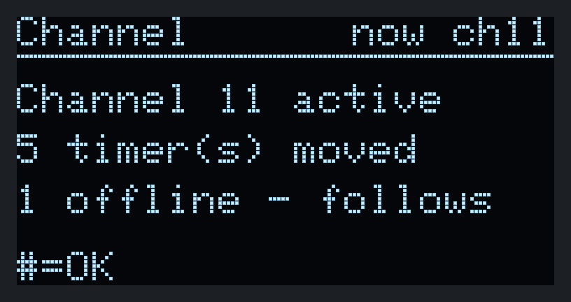<br><sub>System moved to a new channel</sub></td>
<td align="center">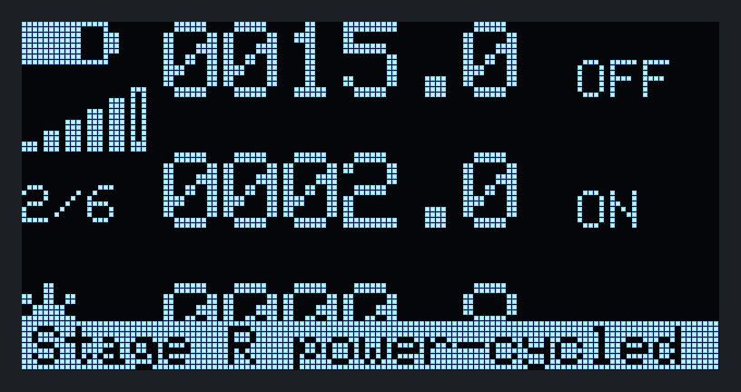<br><sub>Notices: "power-cycled", "no answer"…</sub></td>
</tr>
</table>

All 46 screens are in [`docs/images/oled`](docs/images/oled).

### Fog Console (PC)

<table>
<tr>
<td><br><sub><b>Dashboard</b> – a card per timer</sub></td>
<td><br><sub><b>Device</b> – times, timeline, link history</sub></td>
</tr>
<tr>
<td><br><sub><b>Channels</b> – survey, migration, link lab</sub></td>
<td><br><sub><b>Diagnostics</b> – counters of the remote and every timer</sub></td>
</tr>
<tr>
<td><br><sub><b>Firmware</b> – update a device over USB (shown on the simulated chip)</sub></td>
<td><br><sub><b>Pairing</b> – discover and pair timers</sub></td>
</tr>
</table>

More in the [Fog Console manual](docs/FOG_CONSOLE_MANUAL.md).

## Quick start

1. **Install** VS Code with the *PlatformIO IDE* extension (or the PlatformIO CLI) and, for the PC tool, the *.NET 10 SDK*.
2. **Flash** the firmware (the same timer firmware goes on every timer):
   ```powershell
   pio run -d FogMachineTimer -t upload
   pio run -d FogMachineRemoteControl -t upload
   ```
   Or, without PlatformIO, from Fog Console: plug the device in, open **Firmware** (`Ctrl+7`), pick the image, **Flash firmware**
   ([how](docs/FIRMWARE_UPDATE.md)).
3. **Pair:** on the remote hold `#` → *Pair Timer* → pick a timer → `#`. Rename it, set the times (`#` on the main screen).
4. **Try it:** hold `*` to fog, tap `*` to toggle the cycle.
5. **PC tool:** connect the remote by USB and run
   ```powershell
   dotnet run --project PCDiagnostics/FogConsole/FogConsole.csproj            # real hardware
   dotnet run --project PCDiagnostics/FogConsole/FogConsole.csproj -- --sim   # offline demo
   ```

The full walkthrough is in the [user manual](docs/MANUAL.md#4-first-time-setup).

## Hardware

| | Remote | Timer |
|---|--------|-------|
| Board | Seeed XIAO ESP32-C3 | Seeed XIAO ESP32-C3 |
| Extras | SSD1306/SSD1315 OLED 128×64 (I²C), 4 buttons, LiPo + charger, 2×200 kΩ divider on A0 | relay / machine trigger on **D3 (GPIO5)**, active high |
| Pins | UP=GPIO3, DOWN=GPIO4, #=GPIO9, \*=GPIO10, SDA/SCL=GPIO6/7, COMM LED=GPIO5 | optional status LED (`-DFOG_STATUS_LED_GPIO=…`) |

Only UP/DOWN (GPIO 3/4) can wake the ESP32-C3 from deep sleep. **Check the timer's output pin against your relay board**
(`FogMachineTimer/src/Pins.h`) and add a pull-down so the relay stays off while the chip boots. Full table: [manual §3](docs/MANUAL.md#3-parts-and-wiring).

## Documentation

| Document | For |
|----------|-----|
| [**User manual**](docs/MANUAL.md) ([HTML](docs/MANUAL.html)) | Using the remote and the timers: setup, buttons, every menu screen, troubleshooting |
| [**Fog Console manual**](docs/FOG_CONSOLE_MANUAL.md) | The Windows tool, page by page, with screenshots |
| [**Firmware update**](docs/FIRMWARE_UPDATE.md) | Updating the remote and the timers over USB: modes, flash map, safety, recovery, how it works |
| **Design specifications** | |
| [Radio protocol & design (FogLink 2)](docs/RADIO_PROTOCOL.md) | Frame format, delivery model, channels, power-cut behaviour, why the old link failed |
| [USB protocol (FogSerial/2)](docs/SERIAL_PROTOCOL.md) | JSON-lines protocol between the PC tool and a remote/timer, incl. performance counters |
| [Legacy designs](docs/legacy) | Superseded specs and the original single-device version, kept for history |
| Per-project notes | [`FogMachineTimer`](FogMachineTimer/README.md) · [`FogMachineRemoteControl`](FogMachineRemoteControl/README.md) · [`PCDiagnostics`](PCDiagnostics/README.md) |

## Repository layout

```
FogMachineTimer/            timer firmware (PlatformIO project)
FogMachineRemoteControl/    remote firmware (PlatformIO project)
lib/FogLink/                shared protocol, radio, storage, USB JSON link (pure C++ core is host-tested)
PCDiagnostics/              Fog Console (WPF, .NET 10) + tests + screenshots
docs/                       manuals, specifications, pictures
tools/native-tests/         host-side protocol simulation (198 checks)
tools/oled-preview/         renders every OLED screen to PNG with the real drawing code
tools/make-manual-html.py   builds docs/MANUAL.html
tools/package-firmware.ps1  builds both firmwares and stages them for Fog Console's Firmware page
src/, platformio.ini, ...   (repository root) the ORIGINAL single-device SmokeMachineTimer — untouched, see docs/legacy
```

## Building and testing

```powershell
pio run -d FogMachineTimer                 # build timer firmware
pio run -d FogMachineRemoteControl         # build remote firmware
dotnet build PCDiagnostics/FogConsole.sln  # PC tool
dotnet test  PCDiagnostics/FogConsole.sln  # PC tool tests

powershell -File tools/native-tests/run.ps1    # protocol simulation: the REAL timer + remote code vs. a lossy radio
powershell -File tools/oled-preview/run.ps1    # render all OLED screens (needs one firmware build first)
python tools/make-manual-html.py               # rebuild docs/MANUAL.html (pip install markdown)
powershell -File tools/package-firmware.ps1    # build both firmwares and stage them next to Fog Console
```

The PlatformIO platform is pinned (`espressif32@8.0.0` → Arduino-ESP32 3.3, ESP-IDF 5.5) so builds are reproducible; the first
build downloads about 1 GB of toolchain. The host tools need Visual Studio's C++ build tools (`cl.exe`).

What the host simulation covers: ten timers under 10–30 % packet loss with MAC retries and lost ACKs, power cuts and rapid
power cycling, commands that must never run twice or late, the dead-man lease, channel migration with an offline timer,
recovery of a late timer on the old channel, `millis()` wrap-around, and a 10-minute soak with random power cuts.

## Safety

The relay switches the trigger input of a smoke machine. If you switch mains voltage, the wiring must be done by a qualified
person with parts rated for the load. Outputs are off at power-up and after every reset; *hold to fog* is a dead-man switch.
Follow the machine maker's instructions and the venue's rules for fog and smoke detectors, and never leave machines
unattended. The radio link is **not encrypted** — see [manual §2](docs/MANUAL.md#2-safety).

## Status

Firmware 2.0 compiles for both targets and the protocol logic is verified by host simulation. It has **not yet been run on
hardware**; test with the machines disconnected first and please report what you find. The same goes for the USB firmware
update in Fog Console: its flasher is tested against the real esptool and a simulated chip, but not yet on a real board
([what has been verified](docs/FIRMWARE_UPDATE.md#8-what-has-been-verified)).

## License

No license file has been added yet — until one is, all rights remain with the author.
