# Fog Console — User Manual

*The Windows tool for the FogMachine remote system · works as a second remote, a configurator and a link debugger*

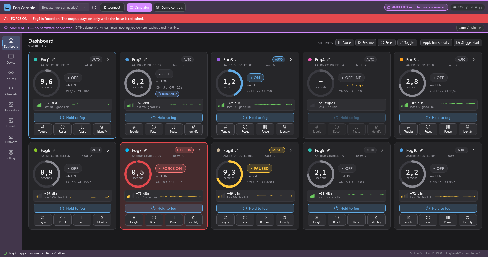

## Contents

1. [What it does](#1-what-it-does)
2. [Install and start](#2-install-and-start)
3. [The first screen: connect or try the demo](#3-the-first-screen-connect-or-try-the-demo)
4. [The window](#4-the-window)
5. [Dashboard](#5-dashboard)
6. [Device](#6-device)
7. [Pairing](#7-pairing)
8. [Channels and Link Lab](#8-channels-and-link-lab)
9. [Diagnostics](#9-diagnostics)
10. [Console](#10-console)
11. [Firmware](#11-firmware)
    * [Over the air (through the remote)](#over-the-air-through-the-remote)
12. [Settings](#12-settings)
13. [Offline demo (simulator)](#13-offline-demo-simulator)
14. [A timer connected directly](#14-a-timer-connected-directly)
15. [Safety features](#15-safety-features)
16. [Troubleshooting](#16-troubleshooting)
17. [Command line, files and shortcuts](#17-command-line-files-and-shortcuts)

> **Terminology:** “fog machine” (fogger) and “smoke machine” are both common. “Fog” is the US trade name, “smoke machine” the UK/Danish everyday term. Neither makes real smoke. I use “smoke machine” for the machine and “fog” for the burst.

---

## 1. What it does

Fog Console talks to the **remote** over its USB cable (protocol: [`SERIAL_PROTOCOL.md`](SERIAL_PROTOCOL.md)). Through the
remote's radio it can do everything the remote's buttons do — for **all ten timers at once** — and more:

* **Remote control:** hold-to-fog, toggle, reset, pause and resume, change ON/OFF times (single timer or all), stagger the
  machines so they do not all fire together.
* **Configuration:** rename, start phase after a power cut, pair and unpair, remote settings (TX power, brightness, Auto Off, signal
  bars, battery calibration).
* **Radio tools:** channel survey, moving the whole system to a quiet channel, finding timers that were away, link tests.
* **Debugging:** the performance counters of the remote and of every timer, health hints, history graphs, a packet inspector, the
  device log and a raw command line.
* **Firmware update:** put new firmware on the remote or on a timer over USB, with checks and verification — no PlatformIO needed — and update the
  timers **over the air**, through the remote, while they stay inside their machines (see [§11](#11-firmware)).
* **Offline demo:** a built-in simulator with up to ten virtual timers, so you can learn the tool without any hardware.

The remote stays awake while the PC is connected. When the PC goes away the remote's normal Auto Off behaviour applies again.

---

## 2. Install and start

Requirements: Windows 10/11 and the **.NET 10 SDK** (`dotnet --version` should say 10.x). From the repository folder:

```powershell
dotnet build PCDiagnostics\FogConsole.sln -c Release
dotnet run --project PCDiagnostics\FogConsole\FogConsole.csproj               # normal start
dotnet run --project PCDiagnostics\FogConsole\FogConsole.csproj -- --sim      # start straight into the offline demo
```

The program ends up in `PCDiagnostics\FogConsole\bin\Release\net10.0-windows\FogConsole.exe` — make a shortcut to it if you like.

**The window always starts maximized.** Un-maximize it and it returns to the size and position you last used. The layout adapts
from a 1000 px wide window up to 4K: dashboard cards reflow into as many columns as fit.

The theme follows Windows (light or dark) and can be changed in [Settings](#12-settings). Every page looks like this in both themes:

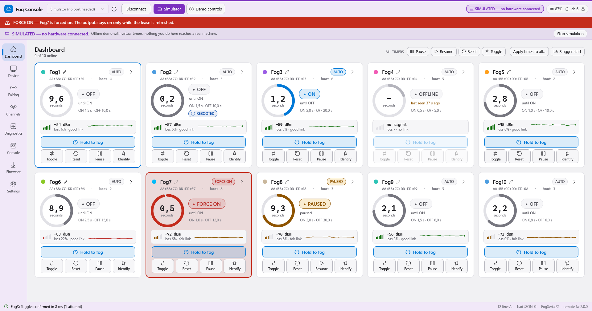

---

## 3. The first screen: connect or try the demo

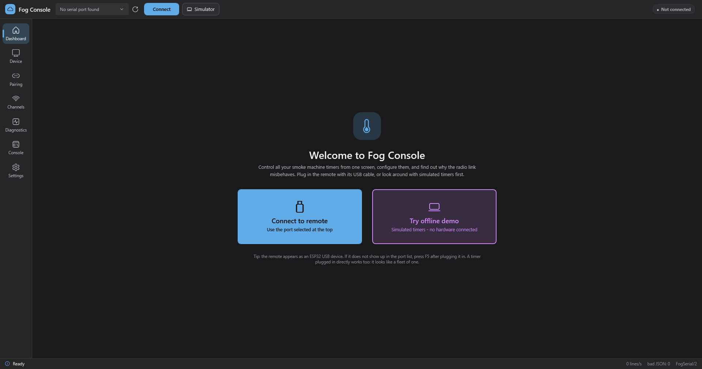

* **Connect to remote** — plug the remote in with a USB data cable. The ESP32 device is recognised and pre-selected in the port
  list at the top left (press **F5** or the refresh button if the list is empty). Press **Connect**.
  If the remote is asleep or unplugged the tool simply waits and connects by itself when the port appears; it also reconnects
  after the remote restarts (reboot, factory reset, channel change).
* **Try offline demo** — starts the simulator (see [§13](#13-offline-demo-simulator)). Nothing is connected to real machines.

---

## 4. The window

* **Top bar** — port list, **Connect/Disconnect**, **Simulator**, and on the right the connection chip (state and latency) and
  the remote chip (battery %, USB/charging, channel).
* **Navigation rail** (left) — Dashboard, Device, Pairing, Channels, Diagnostics, Console, Firmware, Settings.
* **Banners** — a **red banner** whenever any timer is *forced on*; a **violet SIMULATED banner** (and a tinted window) in demo mode.
* **Status bar** (bottom) — the latest command result or error, lines per second on the cable, count of unparsable lines,
  protocol version and the remote's firmware version.
* **Toasts** — failures appear in the bottom right corner until you close them, e.g. *“Fog2 did not answer — it may be powered off
  while heating”*.

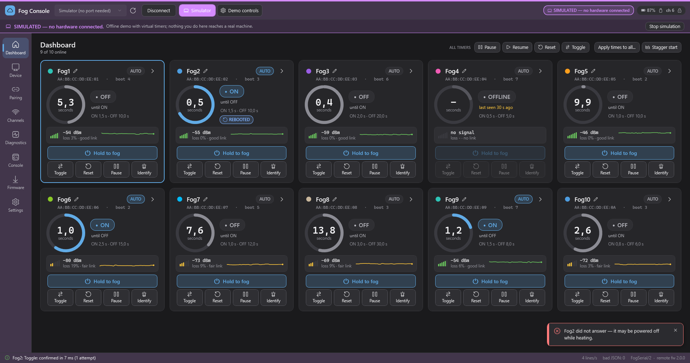

---

## 5. Dashboard

One **card per timer**, ten at most. Everything on a card updates live (the ring is smoothed between the remote's updates).

| Part of a card | Meaning |
|----------------|---------|
| Coloured dot + name | The timer. The dot is its colour tag. The name is a **nickname that exists only on this PC** — click the pencil (or double-click the name) to change it. To rename the timer itself use the [Device page](#6-device) |
| `AUTO` / `FORCE ON` / `PAUSED` | Mode of the timer |
| `boot 4` | The timer's power-up counter. It rises each time the timer lost power |
| **Ring and big number** | Seconds left in the current phase; the ring shows the progress |
| `ON` / `OFF` pill, “until OFF/ON” | Current phase of the cycle (output on or off) |
| `ON 1,5 s · OFF 10,0 s` | The configured durations |
| `REBOOTED` badge | The timer was power-cycled; shown for 30 s |
| **OFFLINE**, “last seen 37 s ago” | No message from the timer for 4.5 s — normal while its machine heats up. The card is greyed out and its buttons are disabled |
| Signal strip | Bars and dBm at the remote, packet loss, a verdict (*good / fair / poor link*) and a small history graph |

**Buttons on a card**

* **Hold to fog** — *press and hold*: the output is forced on, as long as you keep holding (see [Safety](#15-safety-features)).
* **Toggle** — flip the phase now (OFF → ON or ON → OFF); the phase timer restarts.
* **Reset** — output off and the cycle starts again from the beginning of its OFF phase.
* **Pause / Resume** — freeze the cycle with the output off / continue where it stopped.
* **Identify** — blink the timer's status LED for 5 s (needs the optional LED on the timer).
* **Click the card** to select it (the remote's active timer follows), **double-click** to open the [Device page](#6-device).

**Bulk bar (“ALL TIMERS”)** — acts on every timer: **Pause**, **Resume**, **Reset**, **Toggle**, **Apply times to all…** (sets the same ON/OFF
times everywhere) and **Stagger start**, which spreads the phases evenly over the OFF time so that the machines do not all fire at the
same moment. The result of a bulk action is summarised, e.g. *“7/8 confirmed, Fog3 timed out”*.


*In this picture Fog7 is being forced on: its card is red and the banner at the top says so. Fog4 is offline (its machine is heating), Fog2 shows the REBOOTED badge, Fog8 is paused.*

---

## 6. Device

Double-click a card (or choose the timer in the drop-down at the top right) to see everything about one timer.

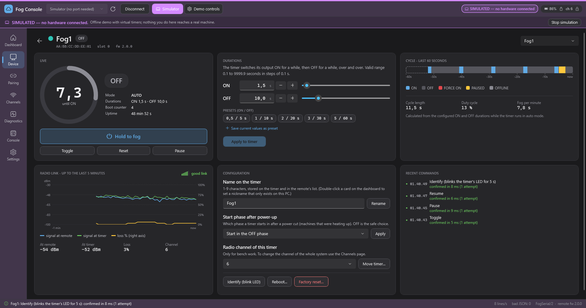

* **Live** — countdown, mode, durations, boot counter, uptime; **Hold to fog**, Toggle, Reset, Pause.
* **Durations** — type or drag **ON** and **OFF** in steps of 0.1 s (valid 0.1 – 9999.9 s), pick a **preset** (`1 / 10 s`…) or *Save current
  values as preset*, then **Apply to timer**. The result (confirmed, rejected, timed out; attempts and time) is shown in *Recent commands*.
* **Cycle – last 60 seconds** — a timeline of ON, OFF, forced, paused and offline periods, with cycle length, duty cycle and fog per minute.
* **Radio link – last 5 minutes** — signal at the remote and at the timer, and packet loss over time.
* **Configuration**
  * **Name on the timer** — renames the timer itself (1–9 characters; it is stored in the timer and in the remote's list).
  * **Start phase after power-up** — which phase the timer starts in after a power cut. OFF is the safe default; choose ON if the machine
    should fire first.
  * **Radio channel of this timer** — for bench work only; to change the channel of the whole system use [Channels](#8-channels-and-link-lab).
  * **Identify**, **Reboot…**, **Factory reset…** — each asks for confirmation.

---

## 7. Pairing

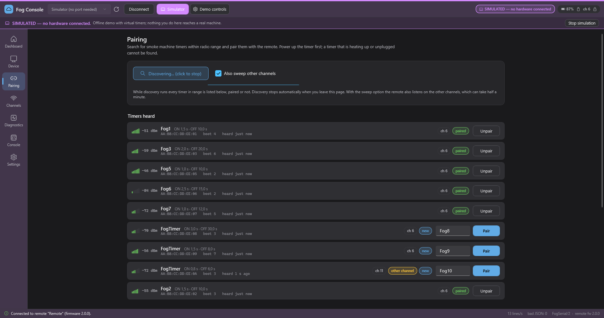

1. Power up the timer(s) near the remote.
2. Press **Discover**. While discovery runs, every timer in range is listed, paired or not.
3. Tick **Also sweep other channels** to find timers that were left on another channel (this can take half a minute).
   Such a timer is marked **other channel**; pairing it also brings it onto your channel.
4. Type a name next to a *new* timer and press **Pair**. **Unpair** removes a paired timer from the remote.

Discovery stops by itself when you leave the page. Up to ten timers can be paired.

---

## 8. Channels and Link Lab

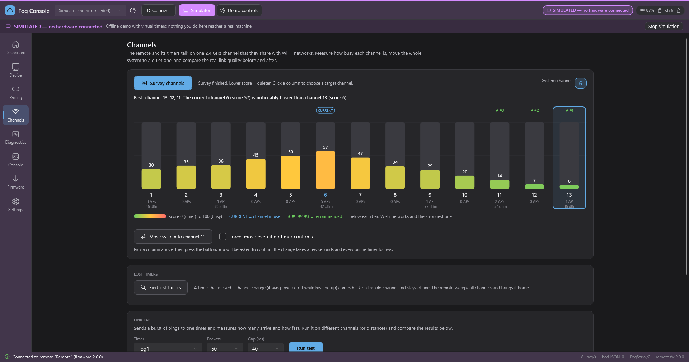

**Survey** — press **Survey channels**. The radio pauses for about 3 s while the remote measures the 2.4 GHz band. Each column is a
channel; the number is its **score (0 = quiet … 100 = busy)**; below it you see how many Wi-Fi networks use it and the strongest one.
`CURRENT` marks the channel in use and `★ #1 #2 #3` the recommendations. Wi-Fi channels overlap their neighbours, so a channel next to a
busy one scores worse than its own traffic suggests.

**Move the whole system** — click a column, press **Move system to channel N** and confirm. The remote tells every online timer, waits until
they confirmed, and then follows. Progress per timer is shown as it happens:

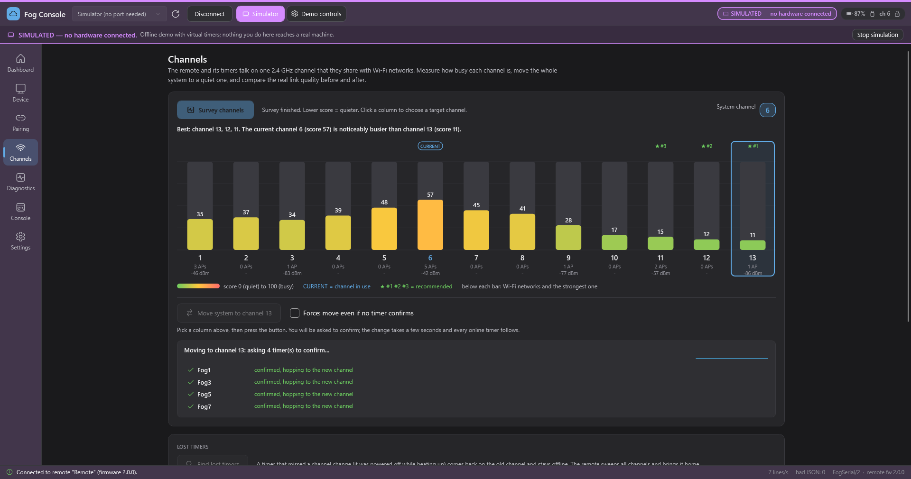

*Force: move even if no timer confirms* changes the channel even when no timer answered (for example when all machines are off).
Without it the change is cancelled, so you cannot lose contact with your timers by accident.

**Lost timers** — a timer that was off while the system moved comes back on the *old* channel and stays offline. **Find lost timers** makes the
remote look on every channel and bring such timers home. (The remote also does this by itself in the background, rarely and briefly.)

**Link Lab** — choose a timer, the number of packets and the gap, then **Run test**: the remote pings the timer and reports how many were
answered, how many the radio acknowledged, the round-trip time and the signal. Earlier tests stay in the list so that you can compare
channels, positions or distances.

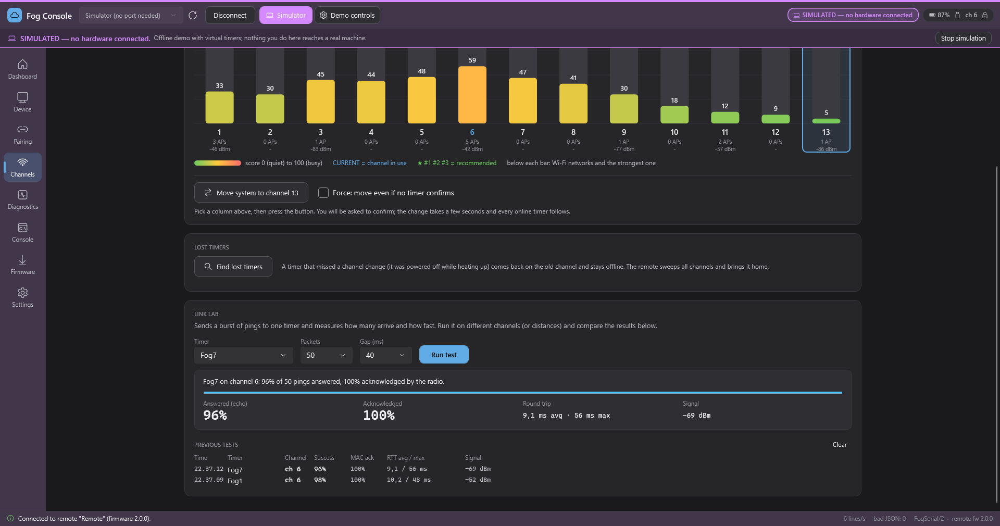

---

## 9. Diagnostics

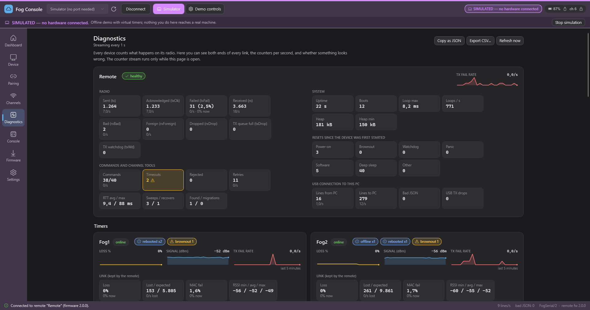

Every device **counts what happens on its radio**. This page shows both ends of every link. The counters are requested once per second,
but only while this page is open.

**Remote panel** — *Radio* (sent, acknowledged, failed, received, bad, foreign, dropped, watchdog), *Commands and channel tools*
(commands, timeouts, rejected, retries, round-trip times, sweeps, recoveries), *System* (uptime, boots, slowest loop, loops per second,
heap), *Resets* since the device was first started (power-on, brown-out, watchdog, panic, software, deep sleep) and the *USB connection to this PC*.
Under each number you see its rate per second.

**One panel per timer** — a header with chips (*online*, *rebooted ×2*, *brownout 1* …), three small graphs for the last five minutes
(**loss %**, **signal**, **TX fail rate**), the link **as the remote sees it** (loss, lost/expected frames, MAC failures, RSSI min/avg/max,
offline time, reboots, commands, retries) and **the timer's own counters** (received, bad, dropped, sent, failed, duplicates, loop time,
brown-outs, power-ons, heap, RSSI at the timer).

**Health chips** call out what looks wrong; hover for the explanation:

| Chip | Means |
|------|-------|
| `loss 25%` | A quarter of the timer's heartbeats do not arrive — interference or distance |
| `macFail 13%` | The receiving radio did not acknowledge many unicast frames — weak link or wrong channel |
| `weak -83 dBm` | Signal is poor |
| `rx drop` | A device overloaded its receive queue (real packet loss inside the device) |
| `slow loop` | The main loop stalled (> 20 ms) — report it |
| `cmd timeout`, `offline ×1` | Commands that were not answered / how often the timer went away |
| `rebooted ×2`, `brownout 1`, `watchdog`, `panic` | Power cuts and resets of the timer |

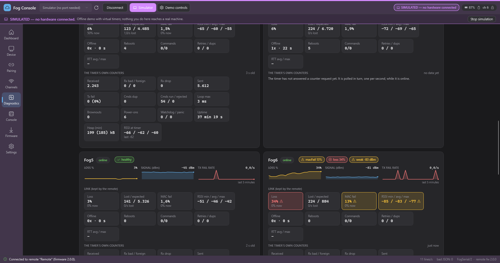

**Channel quality** — a table of transmissions, failures and receptions *per channel*, accumulated since you pressed **Reset**; compare channels
over time. **Snapshot compare** — set a baseline, change something (channel, power, position), and see the difference. **Copy as JSON** and
**Export CSV…** save the numbers for a report.

---

## 10. Console

Three tabs show everything the device says.

* **Log** — the device's log with a level filter (the *Device level* box tells the device how much to send), text filter, **Pause**, **Copy**,
  **Save…**, **Clear** and Auto-scroll.
* **Packets** — every radio frame the remote sees or sends (direction, time, address, type, length, signal, sequence, hex), with filter,
  pause and export. Tick the capture option to start it (it is limited to 30 frames per second).
* **Raw** — every line on the USB cable in both directions, including plain text such as boot messages, and a box where you can send
  your own JSON line (see [`SERIAL_PROTOCOL.md`](SERIAL_PROTOCOL.md)); the history is kept.

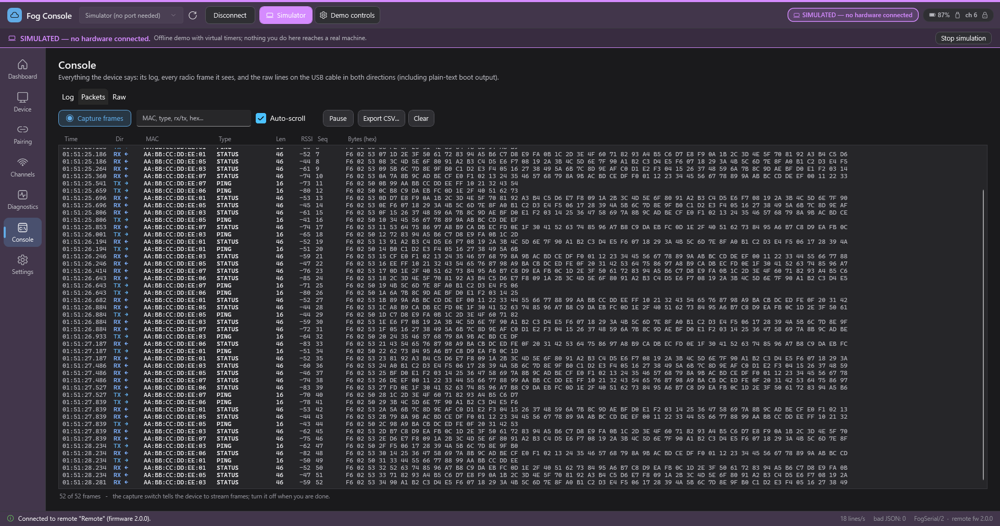

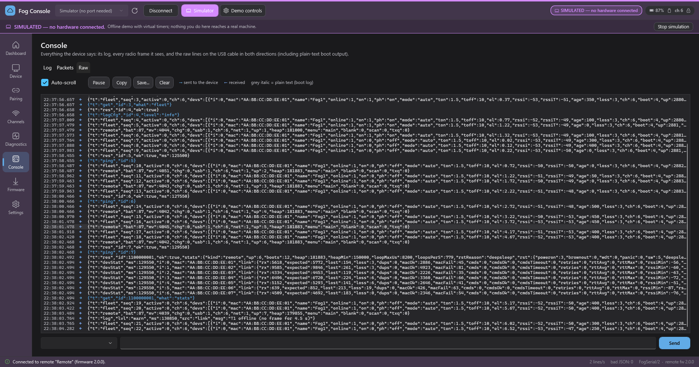

---

## 11. Firmware

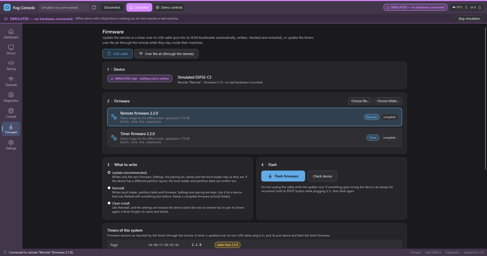

Updates the firmware of the **remote** or of a **timer** without PlatformIO, by one of two **routes** (the switch at the top of the page):

* **USB cable** — the device is put into its ROM bootloader, written and verified on **its own cable**. This is the only way to update the remote, and the
  first update of a timer that has no over-the-air support yet. The rest of this section describes it. The whole story behind the button — flash map, safety,
  how it works, what has been verified — is in [`FIRMWARE_UPDATE.md`](FIRMWARE_UPDATE.md).
* **Over the air (through the remote)** — the timers are updated through the remote's radio while they stay in their machines; see
  [below](#over-the-air-through-the-remote).

**1 · Device.** The serial port of the device to update. If the tool is connected to a port, that one is pre-selected and the card says what
it is (*Remote “Fogger” · firmware 2.0.0*). The tool closes its connection for the update and restores it afterwards. A remote in deep sleep
has no port: press UP or DOWN. A timer needs power from the USB cable while you update it.

**2 · Firmware.** Everything the tool finds: firmware **installed with the app** (a `firmware` folder next to `FogConsole.exe`), the
PlatformIO build output of **this repository**, and what you **chose** with *Choose file…* or *Choose folder…*. Each entry shows what it is
(**Timer** or **Remote**, read from the file itself), its version, whether it is **complete** (boot loader, partition table and
application) or **application only**, and any problem (a damaged file, firmware for another chip). The one that fits the connected
device is pre-selected.

**3 · What to write.**

| Mode | What happens |
|------|--------------|
| **Update** *(recommended)* | Writes only the new firmware. Settings, pairing and names stay. If the device has another partition layout, the boot loader and partition table are written too |
| **Reinstall** | Boot loader, partition table and firmware. Settings and pairing stay |
| **Clean install** | Like *Reinstall*, and the settings are erased: the device starts like new |

*The device is already in download mode* is for the rare case that the automatic reset does not work: hold BOOT, tap RESET, release BOOT, tick the box.

**4 · Flash.** The button starts the update. A bar shows the stage, the amount written, the speed and the time left; **Cancel** stops it.
**Check device** writes nothing: it identifies the chip and its MAC address, compares the flash with the chosen firmware and restarts the device —
the safe first step with a new board or cable. When the chip's MAC address belongs to a timer on the dashboard (or to the remote), the result says so —
*“This is Fog3.”* — so you know you updated the right machine.
Afterwards the page says what was done (*Done: 1 part written, 3 unchanged and verified.*), and — when the tool was connected — which firmware the
device reports after the restart.

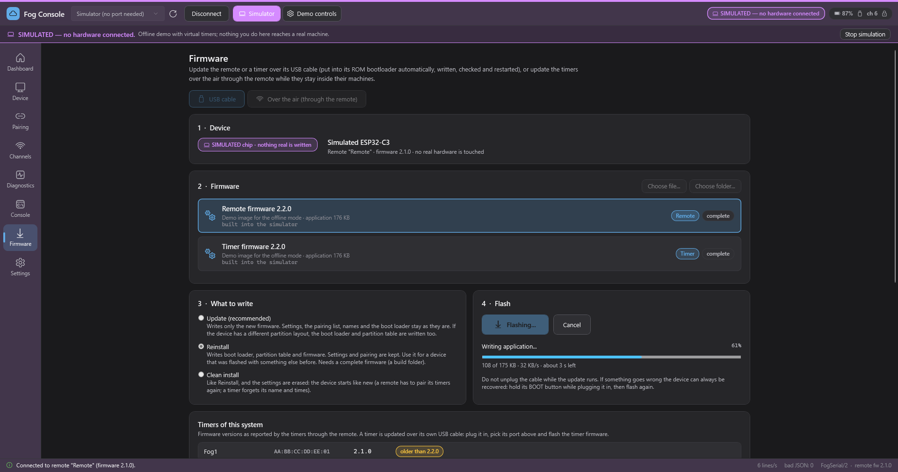

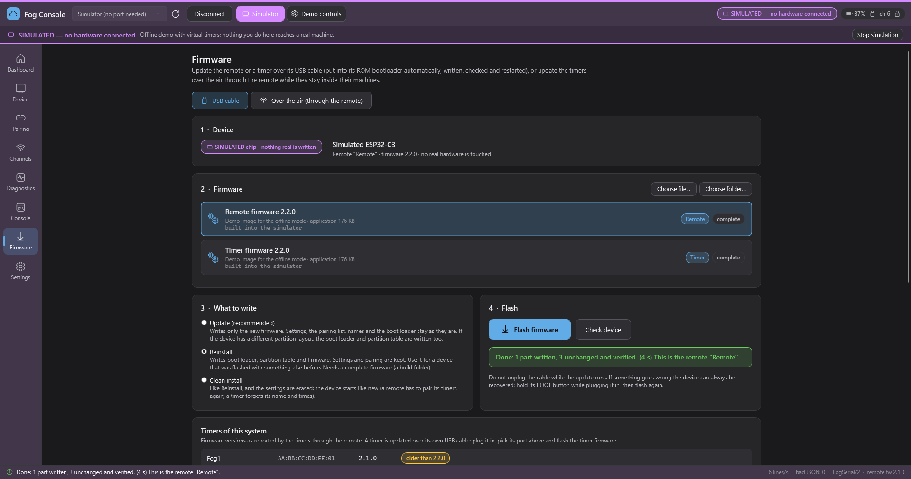

**Timers of this system** lists the firmware version every paired timer reported through the remote, compared with the newest timer firmware
the tool knows: *up to date*, *older than 2.2.0* … Use it to see which timers still need the update; each one is then updated on its own cable —
or, when it has over-the-air support, [through the remote](#over-the-air-through-the-remote).
The **Log** records every step; *Copy* puts it on the clipboard for a bug report.

**It asks before it does something questionable:** timer firmware for a remote (or the reverse), a file that does not say which kind it is, and a
clean install. A damaged or wrong-chip image cannot be flashed at all; the image is checked (header, chip, checksum, SHA-256) before the
cable is touched. Closing the window during an update asks for confirmation.

In the **offline demo** the page works on a *simulated* chip and two demo images: you can run the complete procedure, including a cancel, with
nothing connected.

### Over the air (through the remote)

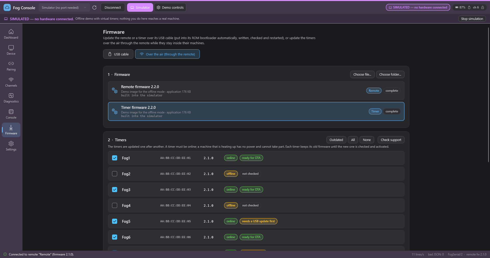

Choose **Over the air (through the remote)** at the top of the page. The timers stay inside their machines; the firmware travels from the PC over
the remote's USB cable and its radio to the timer. The PC runs the whole transfer; the remote only forwards the radio frames. A timer writes the new
firmware into its **second application slot** while the old one keeps running, checks it, switches over and restarts. If the new firmware does not
start, the boot loader goes back to the old one by itself. The protocol and the safety reasoning are in [`OTA_UPDATE.md`](OTA_UPDATE.md).

**What you need.** The connected remote must run firmware 2.1.0 or newer (it announces the capability *ota*); otherwise the page says
*“The remote's firmware … cannot forward firmware updates to timers. Update the remote over USB first”*. A timer needs the two-slot layout:
**the first update of a timer is always over its USB cable** (the *Update* mode installs the new partition layout and keeps settings and pairing).
After that, every update can be done over the air. A timer that is plugged into the PC directly can be updated over its own cable the same way ([§14](#14-a-timer-connected-directly)).

**1 · Firmware.** The same list as for the USB route. Choose a **timer** firmware: the page refuses a firmware for the remote, a file that does
not carry the timer's identity string, a damaged file and an image for another chip — and says why, in words, above the *Update* button.
Only the application image is sent; boot loader and partition table are never touched over the air.

**2 · Timers.** One row per paired timer with its name, address, the firmware version it runs, whether it is **online**, and what it can do:

| Chip | Meaning |
|------|---------|
| `ready for OTA` | The timer answered the check: it has a second slot and is idle |
| `needs a USB update first` | The timer answered, but it has no second application slot. Update it once over its USB cable |
| `no OTA firmware` | The timer did not answer: its firmware has no over-the-air support (or it is out of range). Update it once over USB |
| `busy with another update` | The timer is already receiving something |
| `not checked` | Nobody has asked yet |

**Check support** asks the ticked timers (all, when none is ticked) and changes nothing on them. **Outdated** ticks the online timers whose version is older
than the chosen firmware; **All** and **None** do what they say. A timer that is *offline* — its machine is heating up, so it has no power — cannot take part
and is skipped with a note.

**3 · Update.** **Update selected timers** works through the ticked timers **one after another**. Each row shows what is happening — *Waiting*,
*Contacting the timer*, *Preparing the timer's flash*, *Sending the firmware* with a bar, the speed, the time left and how many pieces had to be sent again,
*The timer checks the firmware*, *Switching to the new firmware*, *Waiting for the timer to restart* — and ends with *Updated 2.1.0 → 2.2.0 in 11 s*, or with a plain reason why not. **Cancel** stops the update; the timer
that was being updated keeps its old firmware. The **Log** underneath records every step and can be copied for a bug report.

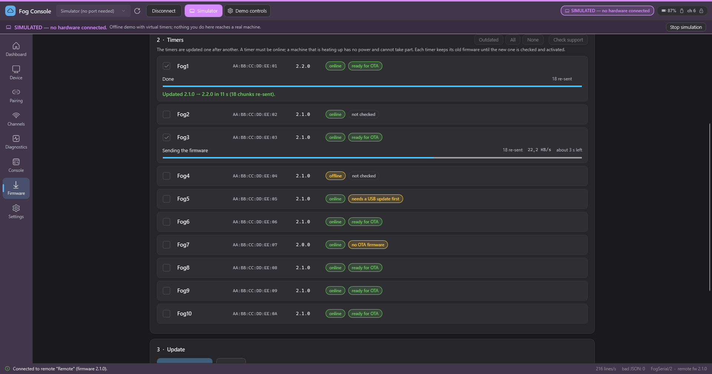

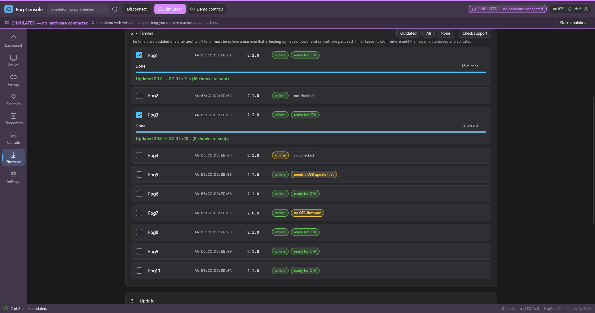

**While an update runs.** The timer keeps cycling; hold-to-fog and the other commands keep working. The remote is kept free for the transfer, so
discovery, channel survey and channel moves, link tests and *Find lost timers* are refused with the note that a firmware update is running. At the end the timer restarts for
a moment — its output is off — and comes back with the new version and a raised boot counter. The tool waits for that, then reports the result. Closing
the window during an update asks for confirmation; the timers that have not switched yet keep their old firmware.

**When something goes wrong** the timer keeps working with its old firmware, and the row says what happened:

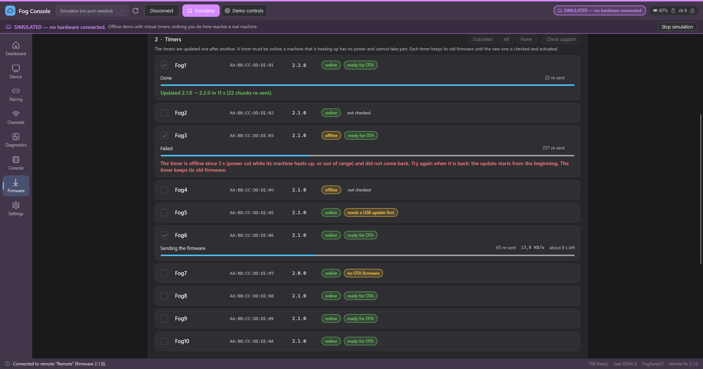

* *The timer is offline … (power cut while its machine heats up, or out of range)* — a machine that heats up cuts the power to its timer. If the timer comes
  back within two minutes the transfer is started again by itself; otherwise the row fails. Try again when the machine has heated up.
* *Loss on the radio* costs time, not correctness: lost pieces are sent again (*“12 re-sent”*), and what the timer wrote is compared with the file by its SHA-256
  before it switches over.
* *The timer rejected the OTA key* — see below.
* *The timer restarted but still runs firmware …* — the new firmware did not come up and the boot loader replaced it by the old one.

**The OTA key.** A timer accepts an update only from a sender that knows the key (a code proves the start request). The key in **Settings → Over-the-air key**
(default `FogLink-OTA-v1`) must be the one the timer firmware was built with. It keeps accidents and neighbours' tools out; it is **not** a secret and no
protection against someone with physical access (see [`OTA_UPDATE.md`](OTA_UPDATE.md#7-safety)).

In the **offline demo** the simulated timers update at an accelerated pace: Fog5 *needs a USB update first*, Fog7 has *no OTA firmware*, a few machines heat up now and
then, and *Demo controls → Cut power* during a transfer shows what a failure looks like.

---

## 12. Settings

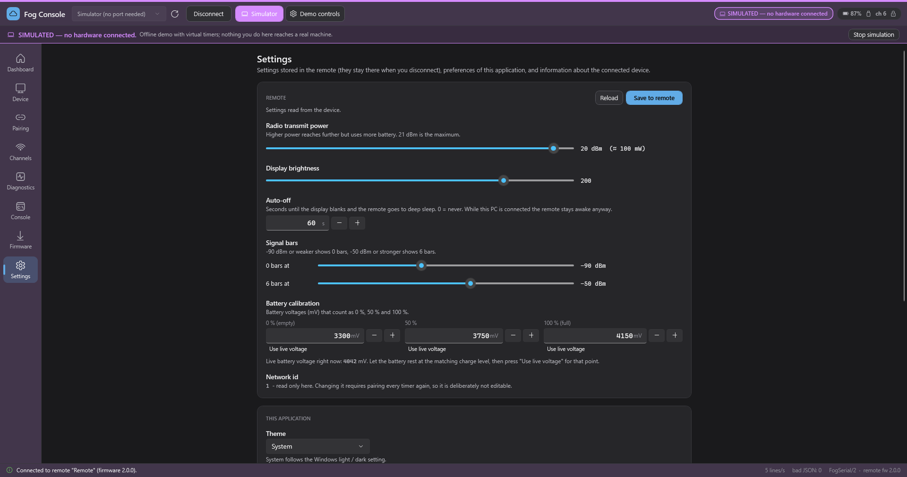

**Remote** (stored in the remote; **Reload** reads them again, **Save to remote** writes them):

| Setting | Meaning |
|---------|---------|
| Radio transmit power | 2 – 21 dBm (default 20 dBm = 100 mW, the EU limit) |
| Display brightness | OLED contrast |
| Auto-off | Seconds until the display blanks and the remote sleeps (0 = never). The remote stays awake while the PC is connected |
| Signal bars | Signal strength that shows as 0 and as 6 bars on the remote |
| Battery calibration | Battery millivolts that count as 0 %, 50 % and 100 %. *Use live voltage* takes the current reading |
| Network id | Read-only (always 1) |

**This application** — theme (System / Light / Dark), how many log/raw lines and packets are kept, what the offline demo pretends to be (applies the next time the simulator starts), the **over-the-air key** (see [§11](#over-the-air-through-the-remote); leave it at the default unless you built the timer firmware with your own) and an *About* box with the connected device's information. Reconnecting after the remote re-appears happens automatically.

---

## 13. Offline demo (simulator)

The demo is a complete, **virtual remote with up to ten virtual timers**; it speaks the very same protocol as the real thing. Start it from the
welcome screen (**Try offline demo**), from the top bar (**Simulator**) or with `--sim`. A violet **SIMULATED** chip, a banner and a tinted
window make sure nobody mistakes it for real machines.

Open **Demo controls** in the top bar:

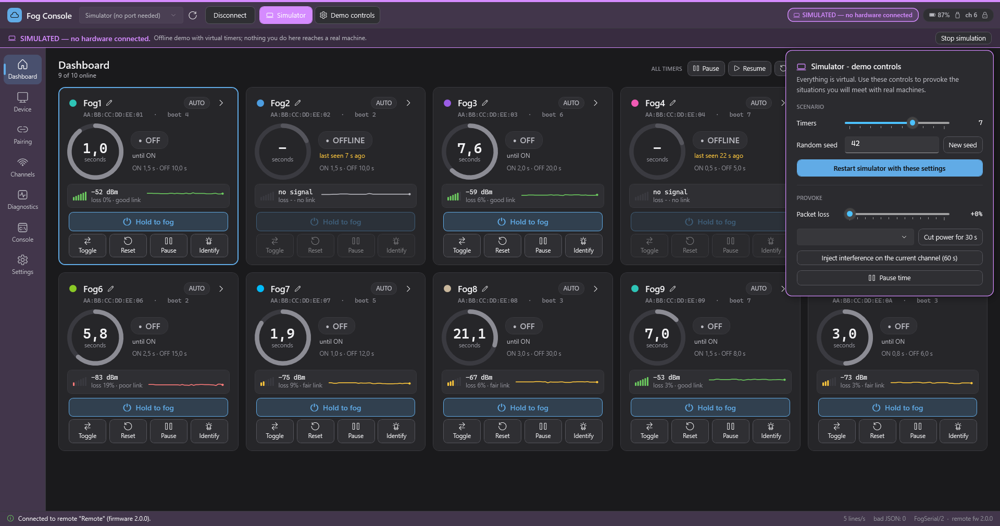

* **Timers** (1–10), **Random seed** (same seed = same story) and **Restart simulator with these settings**.
* **Packet loss** — add artificial loss to every link.
* **Cut power (30 s)** to a chosen timer — it goes offline, comes back with the REBOOTED badge and a brown-out in the counters.
* **Inject interference on the current channel (60 s)** — a jammer appears: run a survey, move to a quiet channel and watch the link recover.
* **Pause time** — freeze the simulation to examine a situation.

Everything works offline: pairing, survey and channel moves, link tests, counters, console and settings. Heating machines (timers that lose power
for a while) are part of the default scenario.

---

## 14. A timer connected directly

Plug a **timer** (not the remote) into the PC and connect: the tool recognises it and treats it as a fleet of one. Fleet functions (pairing, channel
survey…) are hidden; you can configure the timer (name, ON/OFF times, start phase), control it, watch its log and see its own counters under
Diagnostics. This is the easiest way to prepare a timer on the bench before it goes on a machine — and the place to put the newest firmware on it ([§11](#11-firmware)).
A timer with over-the-air support can also take its update over this cable through the *Over the air* route: the list then has one row, and no remote and no radio are involved.

---

## 15. Safety features

* **Hold to fog is momentary.** The output is forced on only while you hold the button (or the space bar while the button has the focus). The tool
  refreshes the command every 0.3 s; letting go, switching to another window, losing focus or losing the connection releases it. And even if the PC
  crashes, the timer's own **1-second lease** runs out and the output returns to its cycle.
* A **red banner** across the top shows whenever any timer reports *force on*.
* **Destructive actions ask first:** factory reset, reboot, unpair, moving a timer or the whole system to another channel, resetting all timers.
* **Every command shows its real result:** confirmed (with attempts and time), rejected, or timed out with a plain explanation. A rejected command
  right after a power cut is normal: the rebooted timer refuses commands that were meant for its previous start (it must never fire by surprise) —
  just press again.
* **Firmware updates are checked and verified:** the image must be intact and built for the ESP32-C3, a timer/remote mix-up and a clean install ask first, every
  written part is compared with the file by the chip itself, and a failed or cancelled run still sends the device back to its application.
* **Over-the-air updates cannot brick a timer:** the running firmware is never overwritten (the new one goes into the other slot), a start request needs the
  OTA key, the written image is compared by SHA-256 before the switch, and a firmware that does not come up is replaced by the old one by the boot loader.
  A lost cable, a power cut or a bad radio link only ends the transfer.
* The radio link is not encrypted; see the [user manual](MANUAL.md#2-safety).

---

## 16. Troubleshooting

| Symptom | Cause / what to do |
|---------|--------------------|
| “No serial port found” | Use a **data** USB cable, wake the remote (press UP or DOWN), press **F5**. A remote in deep sleep has no COM port |
| Connects, then “connection lost” repeatedly | Another program (a serial monitor, PlatformIO) has the port; close it. The remote restarts when it is reset by another tool |
| Dashboard is empty after connecting | No timers paired yet → [Pairing](#7-pairing) |
| A timer is **OFFLINE** | Its machine is heating, or it is out of range or on another channel → wait, then **Find lost timers**; check [Diagnostics](#9-diagnostics) |
| “did not answer — it may be powered off while heating” | The command could not be delivered within 2.5 s; repeat when the timer is back |
| “rejected” right after a power cut | See [Safety features](#15-safety-features): just press again |
| The status bar shows `bad JSON: N` | Some line on the cable could not be understood (for example garbage after a reset); harmless if the number does not keep growing |
| Channel move “cancelled” | No timer answered. Power the machines on or tick **Force** |
| The window opens on the wrong monitor | Un-maximize, move it, maximize again — the restored position is remembered |
| Firmware page: “in use by another program” | Close the serial monitor / PlatformIO / second Fog Console that has the port |
| Over the air: “cannot forward firmware updates to timers” | The remote's firmware is older than 2.1.0. Update the remote over its USB cable first |
| Over the air: `needs a USB update first` / `no OTA firmware` | The timer has no two-slot layout or an older firmware: update it **once** over its USB cable (mode *Update*), then use the radio |
| Over the air: “The timer is offline …” | Its machine is heating up (no power) or it is out of range; try again later. The timer keeps its old firmware |
| Over the air: “rejected the OTA key” | **Settings → Over-the-air key** differs from the key the timer firmware was built with |
| Over the air: very slow, many “re-sent” | A poor radio link (see [Diagnostics](#9-diagnostics)): move the remote closer, or choose a quieter channel; it still ends correctly |
| Firmware page: “did not enter its bootloader” | Put the device into download mode by hand (hold BOOT, tap RESET, release BOOT), tick the box on the page, press Flash. More in [`FIRMWARE_UPDATE.md`](FIRMWARE_UPDATE.md#7-troubleshooting) |

If something looks wrong, **Console → Raw** shows the exact lines exchanged, and **Diagnostics → Copy as JSON** captures the counters.

---

## 17. Command line, files and shortcuts

```
FogConsole.exe [--sim] [--sim-timer] [--seed N] [--paired N]
               [--page Dashboard|Device|Pairing|Channels|Diagnostics|Console|Firmware|Settings] [--select N]
               [--theme light|dark|system] [--size WxH] [--no-chaos] [--no-demo] [--no-settings]
               [--shot out.png [--shot-scale 1]] [--delay secs] [--exit] [--action name] [--scroll px]
```

| Option | Meaning |
|--------|---------|
| `--sim` / `--sim-timer` | Start the simulated remote (with timers) / a single simulated timer on USB |
| `--seed N`, `--paired N` | Simulator random seed (default 42) and number of paired virtual timers |
| `--page`, `--select N`, `--theme` | Page, device index and theme for this run |
| `--no-chaos`, `--no-demo` | No random power cuts / no scripted start scenario — reproducible pictures |
| `--shot file.png`, `--delay s`, `--exit` | Save a screenshot after *delay* seconds and quit (this is how the pictures in this manual were made; see `PCDiagnostics\docs\make-screenshots.ps1`) |

**Keyboard:** `Ctrl+1` … `Ctrl+8` switch pages (Dashboard … Settings), `F5` rescans the COM ports.

**Files:** settings are stored in `%AppData%\FogConsole\settings.json` (last port, window size, nicknames and colours, theme, firmware files you picked); unexpected errors are
written to `%AppData%\FogConsole\crash.log`.

More details for developers: [`PCDiagnostics/README.md`](../PCDiagnostics/README.md) and [`PROTOCOL_NOTES.md`](../PCDiagnostics/PROTOCOL_NOTES.md).
