# FogMachine Remote System — User Manual

*Firmware 2.0 · one battery remote · up to ten smoke-machine timers · Windows tool "Fog Console"*

---

## Contents

1. [What it is](#1-what-it-is)
2. [Safety](#2-safety)
3. [Parts and wiring](#3-parts-and-wiring)
4. [First-time setup](#4-first-time-setup)
5. [Using the remote](#5-using-the-remote)
6. [Menu reference](#6-menu-reference)
7. [The timers](#7-the-timers)
8. [Radio, channels and range](#8-radio-channels-and-range)
9. [Fog Console (Windows)](#9-fog-console-windows)
10. [Troubleshooting](#10-troubleshooting)
11. [Maintenance](#11-maintenance)
12. [Technical data](#12-technical-data)
13. [Glossary](#13-glossary)

---

## 1. What it is

The system lets one person run up to **ten smoke machines** from a handheld remote.

* Every machine has a small **timer** (a Seeed XIAO ESP32-C3 and a relay). It switches the machine's trigger in a repeating
  cycle: **OFF for *Toff* seconds, ON for *Ton* seconds**, over and over — each timer with its own times.
* The **remote** (a second XIAO ESP32-C3 with a small OLED and four buttons) shows one timer at a time (the *active* timer)
  and lets you change its times, trigger a burst of fog by hand, and manage all timers from a menu.
* A **PC tool**, *Fog Console*, can do everything the remote does for the whole fleet at once, and also shows the quality of
  every radio link, so problems can be found instead of guessed.

> **Terminology:** “fog machine” (fogger) and “smoke machine” are both common. “Fog” is the US trade name, “smoke machine” the UK/Danish everyday term. Neither makes real smoke. I use “smoke machine” for the machine and “fog” for the burst.

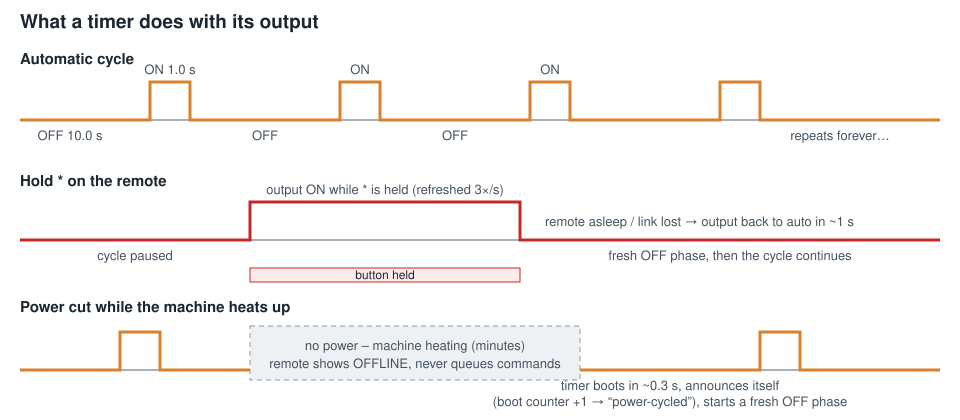

Smoke machines **cut the power to their timer while they heat up**. The timers are designed for that: they wake up again by
themselves, remember their settings, report that they were power-cycled, and the remote never sends them stale commands.

---

## 2. Safety

* The relay in a timer switches **the trigger/remote input of the smoke machine**. If you switch mains voltage with it, the
  wiring must be done by a qualified person and the relay and enclosure must be rated for the load.
* A timer **starts every cycle with the OFF phase** after a power-up, and its output is **off** during start-up and after any
  reset or watchdog event. It never starts with the output on.
* *Hold to fog* (`*` held on the remote) is a **dead-man switch**: the output stays on only while the remote keeps refreshing
  it three times a second. If the remote is released, goes to sleep, runs out of battery or loses the link, the output
  returns to the automatic cycle within about a second.
* Smoke and fog can trigger smoke detectors and affect breathing; follow the machine maker's instructions and the venue's rules.
  Never leave running machines unattended.
* The system has **no encryption**. A remote can only command timers it has *paired* with, but anybody with a compatible remote
  within range can pair with an unpaired-looking timer. If two systems work in the same room, put them on different channels
  and only pair your own timers.

---

## 3. Parts and wiring

### Remote (Seeed XIAO ESP32-C3)

| Function | Pin (GPIO) | Note |
|----------|-----------|------|
| OLED SDA / SCL | D4 (6) / D5 (7) | SSD1306/SSD1315 128×64, I²C 0x3C (alternate pair 4/5 is tried automatically) |
| **UP** | D1 (3) | also wakes from deep sleep |
| **DOWN** | D2 (4) | also wakes from deep sleep |
| **#** | D9 (9) | menu / select / next |
| **\*** | D10 (10) | toggle / fog / back |
| Battery sense | A0 (2) | 2 × 200 kΩ divider (half the battery voltage); add ~100 nF from A0 to ground for a steady reading |
| Charger status | GPIO 20 (CHG), GPIO 21 (PWR) | optional; active high |
| COMM LED | D3 (5) | blinks on radio traffic (optional) |

Only GPIO 0–5 can wake the ESP32-C3 from deep sleep, therefore only **UP** and **DOWN** wake the remote.

### Timer (Seeed XIAO ESP32-C3)

| Function | Pin (GPIO) | Note |
|----------|-----------|------|
| **Relay / machine output** | **D3 (5)**, active high | *verify against your relay board* — change in `FogMachineTimer/src/Pins.h` or with `-DFOG_OUTPUT_GPIO=…` |
| Status LED (optional) | none by default | add `-DFOG_STATUS_LED_GPIO=…`; used by *Identify* and as a link heartbeat |

Add a pull-down resistor (e.g. 10 kΩ) from the output pin to ground so the relay stays off while the chip boots.
Power the timer from a supply that holds up for a few hundred milliseconds (a small capacitor helps when the machine's
thermostat cuts the supply).

---

## 4. First-time setup

### 4.1 Install the tools

1. Install **Visual Studio Code** and the **PlatformIO IDE** extension (or the PlatformIO command line).
2. Open the repository folder. It contains two PlatformIO projects: `FogMachineTimer` and `FogMachineRemoteControl`.
3. For the PC tool install the **.NET 10 SDK** (or just run the published build).

### 4.2 Flash the firmware

* Connect a timer by USB, open `FogMachineTimer`, press **Upload** (PlatformIO picks the port itself).
  Repeat for every timer — the same firmware goes on all of them. Every chip has its own MAC address, which is how the remote
  tells them apart.
* Connect the remote, open `FogMachineRemoteControl`, **Upload**.
* If a board does not show up as a COM port: hold its **BOOT** button, tap **RESET**, release BOOT, then upload.
  For the remote, holding **UP** while it powers up also opens a 60 s *update window* (screen shows “Firmware Update Mode”).

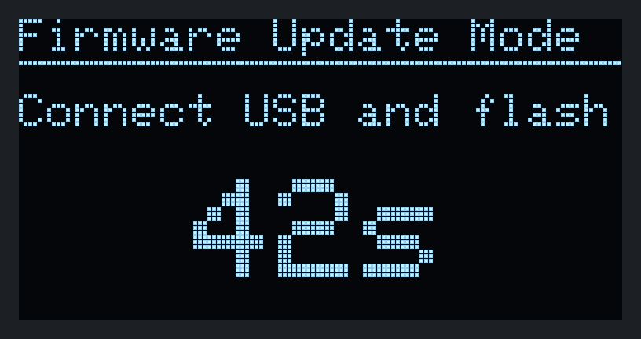

### 4.3 Pair the timers

1. Power up the timer(s) you want to pair, near the remote.
2. On the remote: **hold `#`** until the menu opens → **Pair Timer**.
3. The remote lists every timer it hears (it also searches the other channels): name, last 4 digits of its address and signal
   strength. Pick one with UP/DOWN and press **`#`** to pair. A star (✱) marks timers that are already paired; pressing `#`
   on one unpairs it.

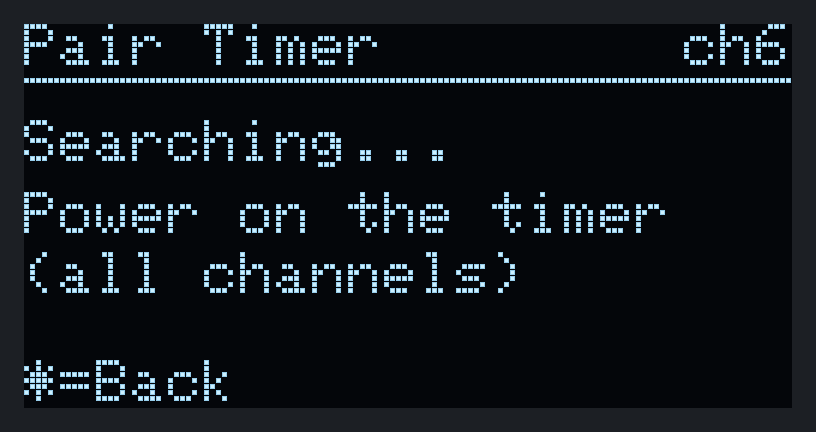 

4. Leave with `*`. The first timer you pair becomes the *active* timer.
5. Rename each timer (**Rename Timer**) so you can tell the machines apart — *Stage L*, *Haze 5*, …

### 4.4 Set the times

Press **`#` briefly** on the main screen. The two rows are the **OFF time (Toff)** and the **ON time (Ton)**, in seconds with
one decimal (0000.0 – 9999.9). Edit digit by digit — see [Edit Timers](#edit-timers). The new times are sent to the timer and
stored there; they survive power cuts.

### 4.5 Test

Hold `*`: the machine fires while you hold it. Release: it returns to its cycle. Press `*` briefly: the cycle flips between ON and OFF.

---

## 5. Using the remote

### 5.1 The main screen

| # | What | Meaning |
|---|------|---------|
| 1 | Battery | Fills with the charge. Blinking = charging; a plug symbol = USB powered |
| 2 | Signal bars | Radio strength of the **active timer** as the timer hears the remote (0–6 bars; scale set in *RSSI Calibration*) |
| 3 | **2/6** | Which timer is active (number of the active timer / paired timers). The name is shown in the *Active Timer* list |
| 4 | ✱ | The **output is on** right now (the machine is being triggered) |
| 5 | OFF | OFF duration of the cycle |
| 6 | ON | ON duration of the cycle |
| 7 | TIME | Seconds elapsed in the current phase. Reads **FOG** while the output is forced on and **STOP** if the timer is paused (from the PC) |

A small **PC** mark in the top right corner means a PC is connected. A blinking square under the index means a command is
still on its way to the timer.

### 5.2 Buttons on the main screen

| Button | Press | Does |
|--------|-------|------|
| **UP / DOWN** | tap | Open the **Active Timer** list (all timers at a glance) |
| **#** | tap | Edit the active timer's ON/OFF times |
| **#** | hold 0.8 s | Open the **menu** (a progress bar appears after 0.5 s) |
| **\*** | tap | **Toggle** the cycle: if it is OFF it turns ON now, and vice versa; the phase restarts |
| **\*** | hold | **Fog while held.** Release returns to the cycle (a fresh OFF phase) |
| UP / DOWN | tap, when the screen is off | **Wake** the remote |

The screen blanks after the **Auto Off** time (default 60 s) and the remote goes to deep sleep to save the battery. A PC
connection keeps it awake. The key that wakes the remote is *not* treated as a command.

### 5.3 Switching between timers

Tap **UP** or **DOWN** on the main screen to open the list of all timers:

* `>` marks the active timer, the highlighted row is the cursor. Each row shows the state of the timer
  (`ON`, `off` = waiting, `--` = offline, `FORCE`, `PAUSE`), a signal indicator, and a small square if it was power-cycled
  recently.
* UP/DOWN move, **`#`** makes the highlighted timer active, `*` goes back.

### 5.4 When a timer goes offline

If nothing was heard from the active timer for about 4.5 s the lower row turns into a white **OFFLINE** box with the number of
seconds since the last message. This is normal while a machine heats up and its timer has no power.

The remote does **not** queue commands for an offline timer: a command that cannot be delivered within 2.5 s is dropped and a
message “*name: no answer*” appears. When the timer returns, the screen shows “*name power-cycled*”.

### 5.5 Messages at the bottom

Short messages appear in a white bar at the bottom for a few seconds:

---

## 6. Menu reference

Hold **`#`** on the main screen to open the menu. **UP/DOWN** move the highlight (the list wraps), **`#`** opens an item and
**`*`** leaves.

 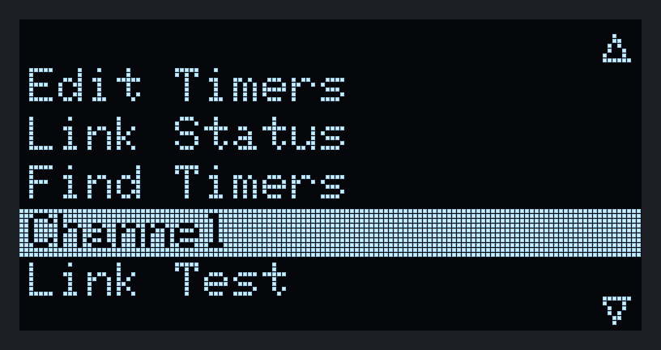

| Item | What it does |
|------|--------------|
| **Pair Timer** | Find and add / remove timers |
| **Rename Timer** | Rename the active timer (stored in the timer and in the remote) |
| **Active Timer** | Choose which timer the buttons control |
| **Edit Timers** | Change Toff / Ton of the active timer |
| **Link Status** | Signal and packet loss of every timer |
| **Find Timers** | Search for timers that went quiet on another channel |
| **Channel** | Survey the 2.4 GHz band and move the whole system to a quieter channel |
| **Link Test** | Send 40 test packets to the active timer and rate the link |
| **Auto Off** | How long until the display switches off and the remote sleeps |
| **OLED Brightness** | Display contrast |
| **Radio TX Power** | Transmit power (default 20 dBm = EU limit) |
| **RSSI Calibration** | Which signal strengths map to 0 and 6 bars |
| **Battery Calibration** | Which battery voltages mean 0 / 50 / 100 % |
| **Reset Timer** | Factory reset of the active timer (name, times, start phase) |
| **Reset Remote** | Forget all timers and restore the remote's defaults |
| **Reboot Remote** | Restart the remote |
| **Sleep Now** | Put the remote to sleep immediately |

### Pair Timer

See [4.3](#43-pair-the-timers). The header shows the channel the remote is on; “Searching…” also scans the other
channels, so a timer left on a different channel is found and brought back to yours when you pair it.

### Rename Timer

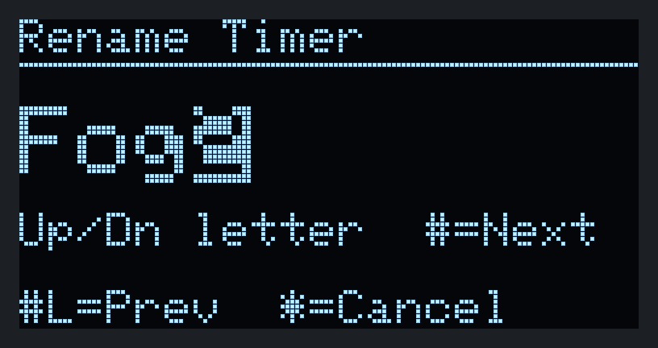

**UP/DOWN** change the letter under the highlight (hold to scroll quickly), **`#`** moves to the next position, **hold `#`**
moves back, and pressing `#` on the last position saves. Names have up to 9 characters (letters, digits, space, `-`).

### Active Timer

See [5.3](#53-switching-between-timers).

### Edit Timers

The ten digits are edited one at a time: the five digits of **Toff** (top row), then the five of **Ton**. The highlighted digit
is the only one that changes (it wraps 9 → 0 without carry). **UP/DOWN** change it (hold to repeat, it speeds up),
**`#`** moves to the next digit, **hold `#`** goes back, and after the last digit the new times are sent. `*` cancels.
Valid range: 0.1 – 9999.9 s.

### Link Status

For every timer: signal strength **R** at the remote, **T** at the timer (dBm; closer to 0 is stronger), and the **packet loss**
over the last ~30 heartbeats. A healthy link shows 0–5 %. `#` asks all timers to report right now.

### Find Timers

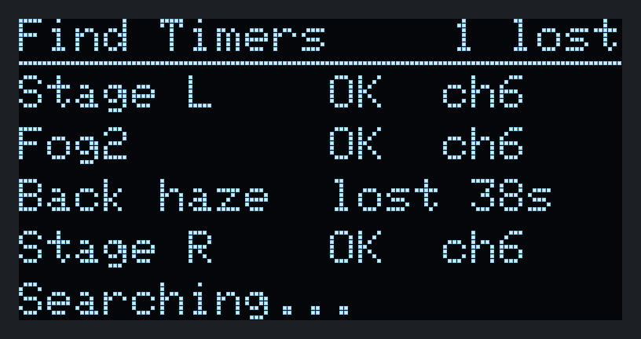

Lists timers with their state; `#` starts a search for those that are offline. A timer that comes back after a power cut on a
channel the remote has left is found within a couple of seconds and moved back. This also runs by itself in the background.

### Channel

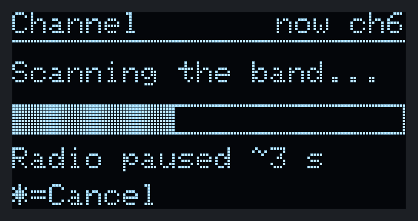 

1. The remote scans the band for about 3 s (it pauses the radio meanwhile).
2. The channels are listed **quietest first** with a bar showing how busy each is (`*` marks the current channel).
3. **`#`** moves the whole system to the highlighted channel, **hold `#`** rescans.

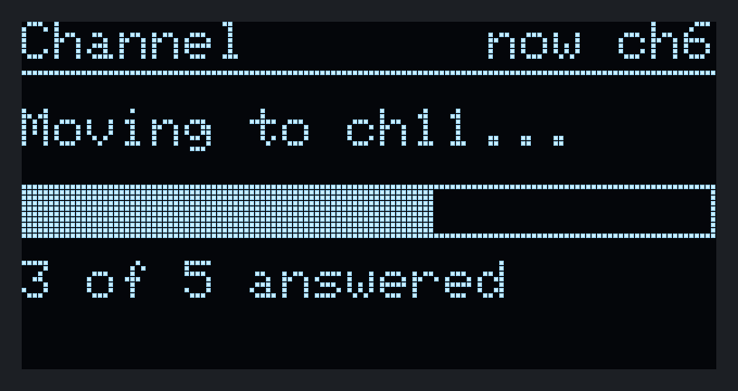 

The remote tells every online timer first and follows once they confirmed. Timers that are powered off keep their old channel
and are fetched automatically when they return. If no timer answers, the change is cancelled so you cannot lose contact
(`#` then offers to force it):

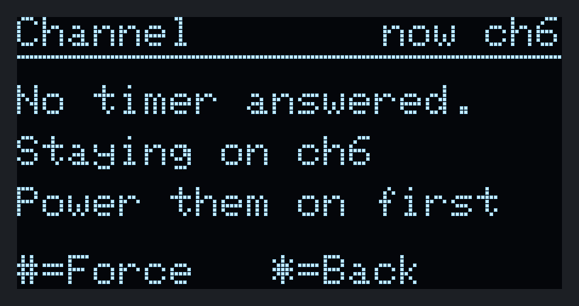

### Link Test

Sends 40 test packets to the active timer. *MAC ack* = the timer's radio received the packet, *Reply* = it also answered.
The verdict is **GOOD** (≥ 95 % answered), **FAIR** or **POOR**, with the average round trip time.

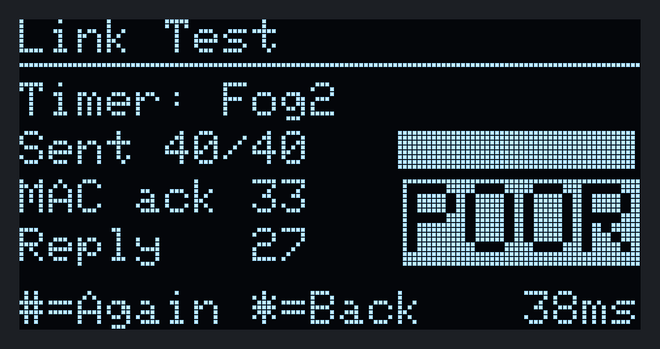

### Auto Off, OLED Brightness, Radio TX Power

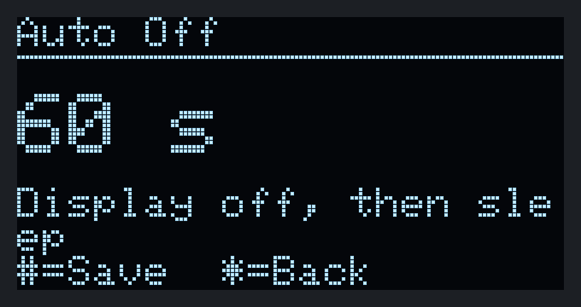 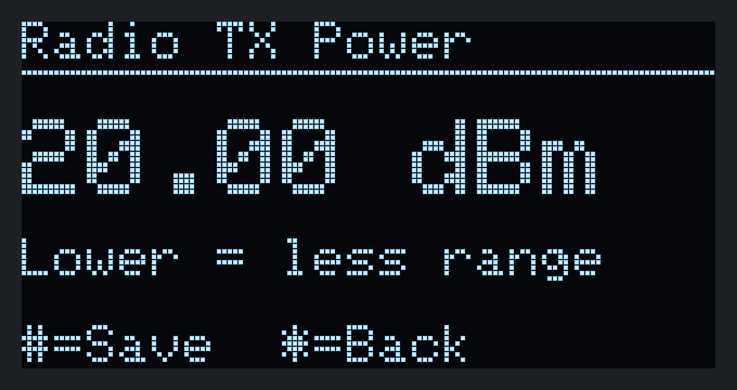 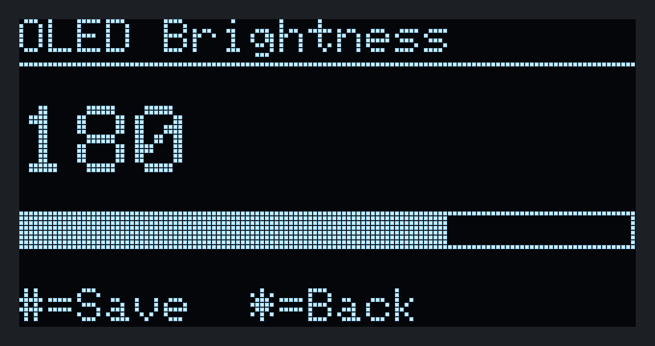

UP/DOWN change the value, `#` saves, `*` cancels. Brightness is previewed live. A lower TX power reduces range; keep it at
20 dBm unless you need to limit interference or regulations require less.

### RSSI Calibration

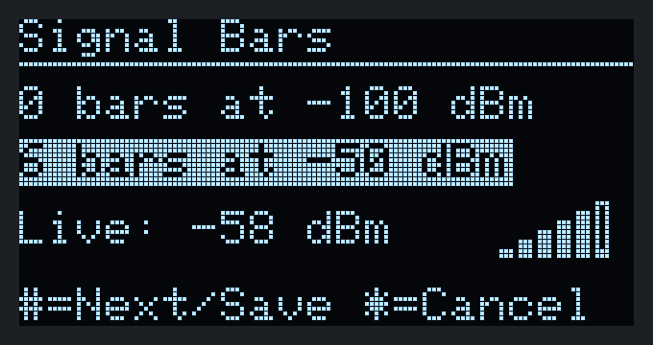

Sets which signal level shows as **0 bars** and which as **6 bars** (`#` switches between the two values, then saves). The
**Live** line shows the current signal of the active timer so you can set the range around your real conditions.

### Battery Calibration

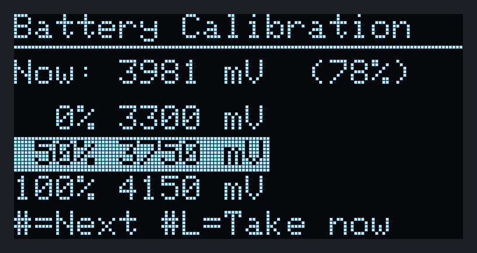

The remote measures the battery voltage in millivolts. Tell it what voltage means 0 %, 50 % and 100 % for your cell
(defaults 3300 / 3750 / 4150 mV). **Hold `#`** copies the live reading into the highlighted value — useful with a fully charged
and a nearly empty battery.

### Reset Timer / Reset Remote / Reboot Remote

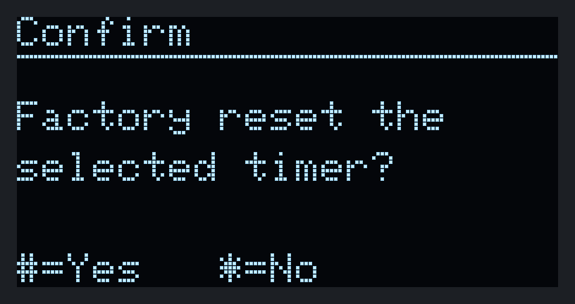

Each asks for confirmation (`#` = yes, `*` = no). *Reset Timer* restores the active timer's factory settings. *Reset Remote*
forgets all pairings and settings.

---

## 7. The timers

### 7.1 What a timer remembers

Toff, Ton, name, home channel and *start phase* are stored in the timer's non-volatile memory — only when they change, in a
power-fail-safe way. It also counts how many times it has been powered up and why it last restarted (power-on, brown-out,
watchdog…). These numbers are visible in the PC tool and help to judge the power supply.

### 7.2 After a power cut

Within a third of a second the timer is on its channel again and announces itself. The remote shows “*name power-cycled*”.
The cycle starts with the **OFF** phase. If you prefer the machine to fire first, set the **start phase** to ON (PC tool).

### 7.3 Modes

| Mode | Output | Set from |
|------|--------|----------|
| **Auto** | follows the OFF/ON cycle | default; released *Hold to fog* |
| **Force on** | on while refreshed (dead-man) | `*` held on the remote, or *Hold to fog* in the PC tool |
| **Paused** | off, cycle frozen | PC tool |

### 7.4 Identify

The PC tool can blink the optional status LED of a timer for a few seconds so you can find the right machine.

---

## 8. Radio, channels and range

* The remote and the timers talk with **ESP-NOW** (2.4 GHz, like Wi-Fi) on a single **home channel** (1–13, default 1).
* **Timers announce themselves every second.** The remote does not poll them; that is why the link stays calm even with ten timers.
* A command is repeated until the timer confirms it (usually the first or second try) or 2.5 s have passed.
* Wi-Fi routers on the same or an overlapping channel are the usual cause of trouble. Use **Channel** to find a quiet one; channels
  1, 6 and 11 do not overlap each other.
* Keep the antenna end of the XIAO boards away from metal and from the relay wiring; mount timers where they can "see" the remote
  rather than behind a machine's metal housing.
* The signal bars show the **timer's** reception of the remote. The **Link Status** screen shows both directions.

How the protocol works in detail: [`RADIO_PROTOCOL.md`](RADIO_PROTOCOL.md).

---

## 9. Fog Console (Windows)

Connect the remote by **USB** and start *Fog Console* (`PCDiagnostics/FogConsole`). Choose the COM port and press **Connect** —
or press **Try offline demo** to explore the program with ten *simulated* timers (a red "SIMULATED" banner is shown the whole
time; nothing is connected to real machines). The demo needs no hardware.

*Everything about the PC tool — every page with pictures, the offline demo, safety features and troubleshooting — is in the separate [**Fog Console manual**](FOG_CONSOLE_MANUAL.md).*

| Page | What it is for |
|------|----------------|
| **Dashboard** | One card per timer: phase, countdown, mode, link quality, offline/power-cycled badges. *Hold to fog*, toggle, reset, pause, identify; bulk actions for all timers (pause, resume, apply times, stagger start) |
| **Device** | Detail of one timer: edit times (with presets), rename, start phase, 60 s cycle timeline, RSSI/loss history, command log |
| **Pairing** | Discover timers (optionally on all channels), pair / unpair |
| **Channels** | Survey, recommended channels, move the whole system, *Find lost timers*, **link lab** (packet tests per timer) |
| **Diagnostics** | Performance counters of the remote **and** of every timer (packets sent/lost/retried, queue overflows, loop stalls, power-up and brown-out counts) with health hints, history graphs and a per-channel quality table |
| **Console** | Log, packet inspector and a raw command line |
| **Settings** | Remote settings (TX power, brightness, Auto Off, signal scale, battery calibration) and app preferences |

The remote stays awake while the PC is connected. If the remote sleeps or is unplugged the app waits and reconnects by itself.

**Connect a timer directly** (USB) to configure and test a single machine at the bench — the app then shows that one timer.

How to read the counters is described in [Troubleshooting](#10-troubleshooting).

---

## 10. Troubleshooting

| Symptom | Likely cause | What to do |
|---------|--------------|------------|
| A timer shows **OFFLINE** | The machine is heating (no power), or the timer is out of range / on another channel | Wait for the machine; if it should be on, check its power; run **Find Timers**; check **Link Status** |
| “*name: no answer*” | The command could not be delivered within 2.5 s | Try again; check the link (Link Test); the timer may be powered off |
| Timer "flaps" between online/offline | Packet loss ≥ 30 %: interference or distance | **Channel** survey → move; improve antenna position; check *Link Status* loss |
| Packet loss high only on one timer | Antenna blocked by metal / far away | Move the timer or the remote; Link Test while moving |
| Output on although nobody holds `*` | *Force on* from the PC tool, or a long hold of `*` | The dead-man lease ends it within a second after the source stops; look for the red banner in Fog Console |
| Timer does not fire right after power-up | Cycle starts with the OFF phase | Set *start phase* = ON in the PC tool, or shorten Toff |
| Remote does not wake | Only **UP / DOWN** wake it; battery may be flat | Press UP or DOWN; charge via USB |
| Screen is dark | Auto Off | Press UP/DOWN; raise Auto Off; keep the PC connected |
| "*name: rejected*" right after a power cut | A *Toggle / fog / reset* command was issued before the timer lost power; the rebooted timer refuses it on purpose (it must never fire by surprise) | Simply press again |
| Name/time changed on the remote but the timer shows old values | The command was dropped (timer offline) | Repeat once the timer is back; values are only stored after the timer confirms |
| After moving the channel one timer is missing | It was off during the move | Power it on: the remote finds it automatically (or use **Find Timers**) |
| Fog Console shows no ports | Remote asleep, no driver, cable is charge-only | Wake the remote; use a data cable; the app reconnects automatically |

### Reading the counters (Diagnostics page)

| Counter | A problem looks like | Meaning |
|---------|----------------------|---------|
| `txFail` / `macFail` high | > 10 % of unicast frames not acknowledged | The receiver does not hear the sender: distance, interference, wrong channel |
| `loss` high but `macFail` low | heartbeats lost | One-way problem (timer's transmitter / antenna) |
| `rxDrop` > 0 | a device overloaded its receive queue | Real packet loss inside the device; report it |
| `loopMaxUs` > 20 000 | the main loop stalled | Something blocked the radio loop; update firmware |
| `rst brownout` / `poweron` rising | power supply sagging or being cut | Expected for machines that heat up; if unexpected, check the supply / capacitor |
| `cmdsDup` > 0 | retransmitted commands were suppressed | Normal on a lossy link; it proves the dedup works |
| `retries` ≫ `cmds` | many commands needed several tries | Link is marginal |

---

## 11. Maintenance

* **Update firmware:** PlatformIO → *Upload*. The remote can be put into a 60 s *update window* by holding **UP** while powering it
  up. All settings are kept (they live in non-volatile storage and have a version check).
* **Factory reset:** *Reset Timer* / *Reset Remote* in the menu, or from the PC tool.
* **Battery:** the remote charges over USB. Calibrate the percentage once with a full and an empty battery.
* **Several systems in one room:** give each system its own channel (**Channel** menu) and pair only your own timers.

---

## 12. Technical data

| Item | Value |
|------|-------|
| Timers per remote | 10 |
| ON / OFF time range | 0.1 … 9999.9 s, resolution 0.1 s, drift-free |
| Radio | ESP-NOW, 2.4 GHz channels 1–13, 1 Mbit/s, 20 dBm (adjustable) |
| Command delivery | acknowledged, retried for up to 2.5 s, never executed twice |
| Heartbeat | every 1 s per timer; “offline” after 4.5 s silence |
| Hold-to-fog lease | 1 s, refreshed every 0.3 s |
| Remote wake-up | UP or DOWN; the fleet picture is back within about a second |
| Storage | NVS with CRC; written only on change |
| PC link | USB CDC, JSON lines — [`SERIAL_PROTOCOL.md`](SERIAL_PROTOCOL.md) |

---

## 13. Glossary

| Term | Meaning |
|------|---------|
| **Smoke machine / fog machine** | The machine a timer switches. Both names are common; this manual says “smoke machine” for the machine and “fog” for the burst (see the terminology note in [section 1](#1-what-it-is)) |
| **Active timer** | The timer the remote's buttons control |
| **Cycle / phase** | The repeating OFF → ON sequence; *phase* = the part you are in |
| **Heartbeat** | The status message each timer broadcasts once a second |
| **Home channel** | The Wi-Fi channel the system uses |
| **Dead-man lease** | A command that expires unless refreshed — used for *fog while held* |
| **RSSI** | Received signal strength in dBm (−50 strong, −90 weak) |
| **MAC ack** | The receiving radio acknowledged a packet at the link layer |
| **Power-cycled** | The timer lost power and started again |
